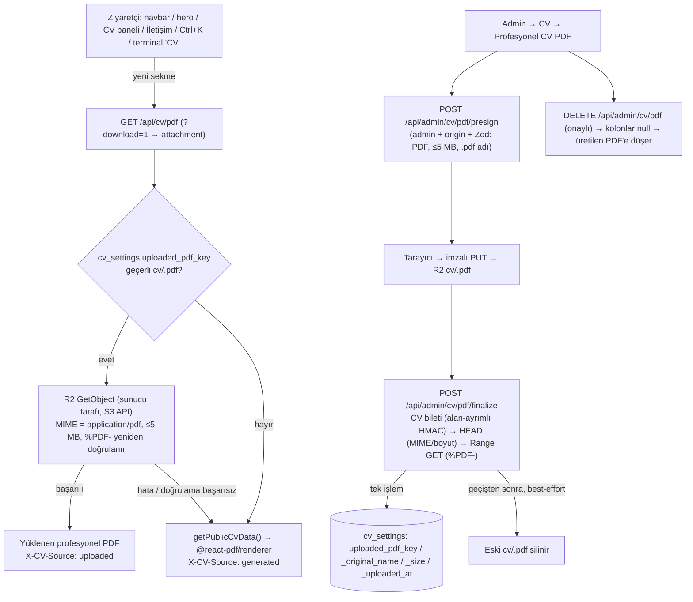
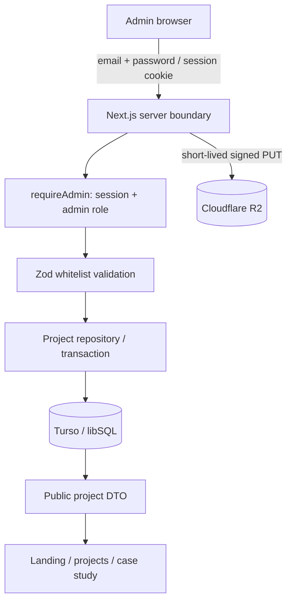
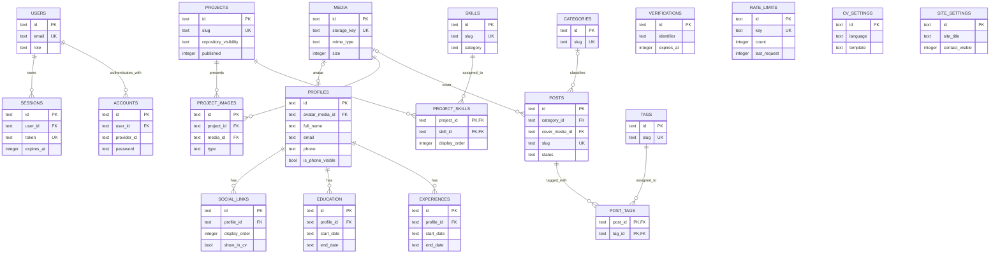
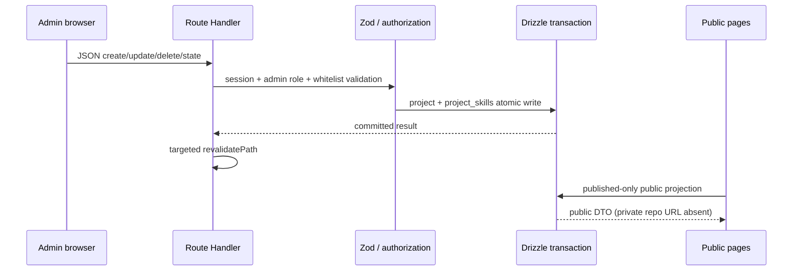
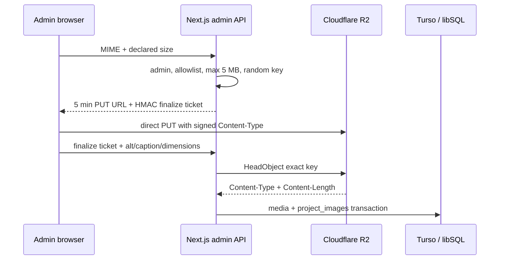
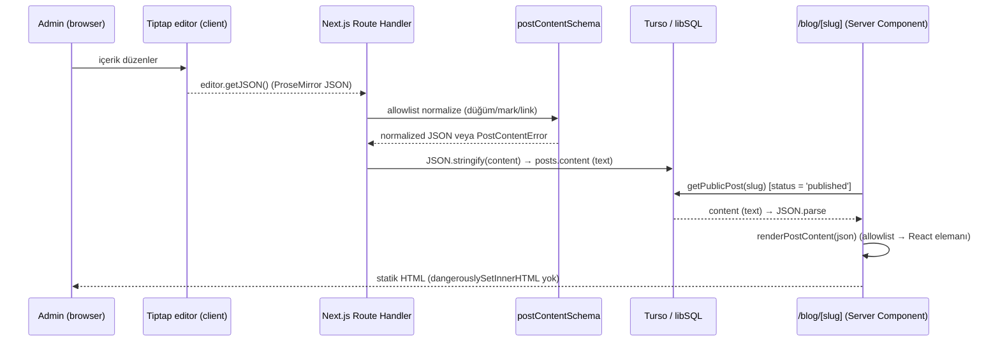
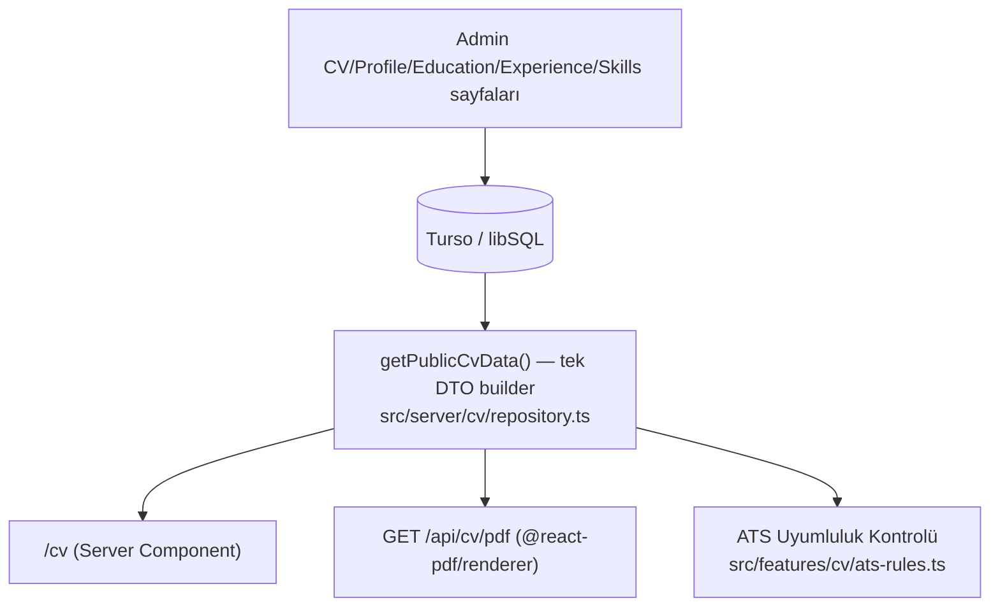

# Sistem Mimarisi

## 1.9.0 — Birincil CV: yüklenen profesyonel PDF, üretilen PDF yedek (2026-10-15)



- Public bağlantı değişmedi (`/api/cv/pdf`); yanıt her zaman `application/pdf`, `X-Content-Type-Options: nosniff`, `Cache-Control: no-store`, sabit dosya adı (`<ad-soyad>-cv.pdf`). Varsayılan `inline`, `?download=1` ile `attachment`. İstekten yalnız `download` okunur; anahtar/URL/yol asla istekten alınmaz.
- PDF aynı origin üzerinden sunulur; ham R2/`r2.dev` URL'si veya imzalı URL public'e verilmez (ADR-092 ağ sorunu bu yolu etkilemez).
- `getCvSettings()` 1.9.0 kolonlarını okumaz (açık kolon listesi). Yüklenen CV meta verisi yalnız `src/server/cv/uploaded-pdf.ts` üzerinden okunur. Böylece migration uygulanmadan önce de Web CV ve public sayfalar çalışır; admin CV sayfası "migration gerekli" uyarısı gösterir.
- Navbar "CV" bağlantısı düz `<a target="_blank">`'tır: API rotası için Next `Link` prefetch'i/istemci yönlendirmesi yapılmaz. Komut paleti ve terminal de `/api/` hedeflerini yeni sekmede açar.
- Test seam: `R2_TEST_ENDPOINT` yalnız production dışında ve yalnız loopback `http://127.0.0.1|localhost:<port>` için S3 istemcisini yerel mock'a yönlendirir (`src/features/media/r2-test-endpoint.ts`); production'da yok sayılır.
- Karar: ADR-095.

## 1.8.3 — Medya teslim yolu (2026-10-10)

R2 gerçek bucket ile yapılandırıldı. Yükleme akışı değişmedi: admin → presign API → imzalı R2 PUT → finalize (HEAD + Range GET magic-byte) → `media` kaydı/public URL → public render. Teslim tarafında `imageDeliveryUrl()` production'da URL'yi olduğu gibi bırakır; yalnız development'ta `https://*.r2.dev` adreslerini `/api/media/r2?url=…` uç noktasına çevirir. Bu uç nokta nesneyi server-side R2 istemcisiyle okur ve yalnız development'ta etkindir (ADR-092).

## 1.8.0 Phase 18 — Certificates veri akışı (2026-09-30)

`src/db/schema/content.ts` içindeki eklemeli `certificates` tablosu ve `drizzle/20260930161354_phase18_certificates/migration.sql` migration'ı içerik alanları, `is_visible`, `show_in_cv`, `display_order`, zaman damgaları, sıra indeksi ve bitiş/veriliş tarih kontrolünü tanımlar. Admin API sunucu yetkilendirmesi ve Zod giriş doğrulaması üzerinden repository'nin oluşturma, güncelleme, silme ve transaction içinde sıralama işlemlerine gider. Public repository SQL düzeyinde landing için `isVisible`, CV için `isVisible && showInCv` süzer; DTO yönetim bayraklarını taşımaz ve saklı doğrulama URL'sini yeniden denetler.

Landing en fazla dört görünür sertifikayı mevcut Data Spine `data-spine-sequence`/`data-spine-item` düzeninde gösterir. Web CV ve React PDF aynı `getPublicCvData()` sonucunu kullanır; boş sertifika bölümü render edilmez. Yerel `drizzle.config.ts`, süreç ortamı önceliğini koruyarak `.env.local` ve `.env` yükler; boş local token `undefined` olarak ele alınır.

## 1.7.0 - Native sticky scenes

Server-rendered altı sequence section outer container; mevcut `.spine-grid[data-pin-scene]` inner viewport'tur. JS measure doğal content yüksekliği, public header yüksekliği ve gerçek `[data-spine-item]` sayısını okur. `pinRange` fit/reduced kararını ve native scroll mesafesini üretir; enabled section height = available viewport + distance, sticky top = header + 16. No-JS ve bypass doğal akıştadır.

`sceneState` traveling/enteringHub/pinnedSequence/leavingHub + continuous progress + sticky offset verir. `pinnedBranch` son %12'yi settle için ayırıp item başına çizgi ve gecikmeli vurgu üretir. Ters yön ayrı state gerektirmez. Pin boyunca core ilgili hub u'suna sabitlenir; travel mevcut coreTarget/damp üzerinden sürer. Indicator label pin section'ında kalır, CSS local fill progress'i yansıtır.

Mevcut DataSpine scroll/rAF loop kullanılır; React state/event interception eklenmez. `shiftStickyRoute` mevcut visual sample buffer'ın yalnız y koordinatını hub offsets arasında interpolate eder; branch group translate aynı offset, core aynı deforme route'tadır. Spline/texture her frame yeniden kurulmaz. Pin sırasında WebGL canvas görseli gizlenir, SVG route aktif kalır; mode değişiminde mevcut renderer route'u senkronlanır.

Measure sırasında sticky geçici natural position'a alınır; font/resize ölçümünün sticky offset'i iki kere sayması önlenir. Root, inner scenes ve header ResizeObserver ile izlenir. Reduced değişince mesafe kaldırılarak layout tekrar ölçülür. İlk hash enhancement sonrası bir kez scene başlangıcına hizalanır; sonraki hash/keyboard/wheel/touch native scroll'dur.

## 1.6.0 — Hub-local branch sequence

Server-rendered landing section'ları `data-spine-sequence`, hedef item'lar `data-spine-item` bildirir. Spine ölçümü her section hub'ının gerçek x/y koordinatını ve item anchor yüksekliklerini cache eder. Tüm branch path'lerinin başlangıcı hub'dır; mobil path dar elbow, desktop path controlled spread cubic'tir.

Saf `branchSequenceEnd` hub'ın scroll penceresini sonraki hub sınırına göre hesaplar; `coreTarget` bu pencere boyunca hub'da bekler. `hasReachedHub` core arrival latch'ini normal scroll, hızlı crossing ve restored/deep-link/resize için korur. `branchSequence` item başına branch draw ve gecikmeli item emphasis üretir.

Mevcut rAF cached numeric state'ten `--branch-call` / `--item-call` yazar; yeni scroll listener veya React scroll state eklenmez. Landing hedeflerindeki ayrı Anime reveal kaldırıldı. Reduced motion nearest hub seçer, item opacity 1 olur; no-JS SSR içeriği okunabilir. Effect disposal guard font-ready/resize callback'lerinin StrictMode cleanup sonrası SVG'yi değiştirmesini önler. Public DTO/privacy ve standalone secondary motif sınırları değişmedi.

## 1.2.0 — Public narrative katmanı

Server `HomePage` public DTO/privacy sorgularını aynen korur. Küçük client `NarrativeController` passive native scroll'u tek rAF ile örnekler; ResizeObserver ölçüleri cache eder. `features/motion/narrative.ts` saf progress/active/shape/config yardımcıları, `narrative-store.ts` sayısal mutable subscription sağlar. Three chunk dynamic import edilir; `NarrativeScene` aynı vertex topolojisini beş prosedürel form arasında interpolate eder. Ambient CSS, primary canvas ve mevcut secondary Skill Universe ayrı bileşenlerdir. Anime reveal ve scroll preview farklı DOM hedeflerine yazar.

Akış: Hero/core → About/flow → Projects/build → Skills/network → Journey/path → Blog/CV/GitHub düşük yoğunluk → Contact/core. Mevcut olmayan optional bölümler atlanır. SSR HTML/CSS fallback, native anchor ve geniş ekran active chapter cue kalır. Reduced-motion change ve kullanıcı seçimi morph/parallax'ı statikleştirir; hidden/overlay/landing dışı pause ve dispose korunur. Eski HeroScene/LandingBackground landing'de mount edilmez. Ayrı CV layout ve tüm backend sınırları değişmedi. Ayrıntılar: [UX raporu](UX_PHASE_REPORT.md).

## 1.1.0 — Korunan UX/CV özellikleri ve önceki hareket mimarisi (2026-09-26)

`shortBio` yalnız landing Hero'da; `longBio` Hakkımda'da kullanılır. CV özeti override → longBio → bölüm yok sırasını izler. Eğitim programı opsiyoneldir; boş/dash-only içerik render edilmez, eski kayıt değiştirilmez. Timeline yalnız eğitim ve deneyimdir; projeler showcase içinde kalır.

Profile `phone` / `isPhoneVisible` ve Social Links `showInCv` additive migration ile eklendi. Telefon güvenli `tel:` normalizasyonu ve görünürlük filtresiyle Contact/web CV/PDF'e ulaşır. CV ve CV shell yalnız `isVisible && showInCv` linklerini alır. GitHub/LinkedIn/Website CV varsayılanı true, diğerleri false; admin değiştirebilir. Instagram, Behance, Dribbble dahil platformlar desteklenir.

PDF artık yerel OFL lisanslı Noto Sans Regular/Bold TTF kullanır; Helvetica kararı bu sürümde geçersiz kılınmıştır. Tek kolon/selectable metin korunur. Terminal header yardımcı kontrolüne taşındı; footer bio/admin/version tekrarlarından arındırıldı. Landing arka planı fixed üç katman, rAF/CSS variables ve section IntersectionObserver kullanır; reduced-motion statiktir. Mevcut Three/Anime sistemleri korunur. FPS/ATS-vendor kabulü iddiası yoktur.

Güncel doğrulama ve sınırlamalar: [UX phase raporu](UX_PHASE_REPORT.md). Önceki phase test sayıları ve kararları tarihsel kayıttır.


Son güncelleme: 26 Eylül 2026 (Academic Final)

## 1. Mevcut Final Mimari

Uygulama Next.js 16 App Router, React 19 ve strict TypeScript üzerinde çalışır.
Landing, public projects, `/admin` ve API route'ları istek anında sunucuda
çalışır. Browser hiçbir zaman Turso, Better Auth veya R2 credential'ına erişmez.



Project domain'i tamamlanmıştır. CV ve Blog yalnız şema düzeyindedir.

## 2. Klasör Yapısı

- `src/app/(public)`: Dinamik landing ve public project liste/detay sayfaları.
- `src/app/admin/(protected)`: Server-side korunan admin shell ve Project CMS.
- `src/app/api/admin/projects`: Admin-only JSON mutasyonları ve upload finalize.
- `src/app/api/auth/[...all]`: Better Auth Next.js route handler.
- `src/components/admin`: Login ve oturum kapatma Client Component'leri.
- `src/db/client.ts`: libSQL tabanlı Drizzle client'ın iç uygulaması.
- `src/db/index.ts`: `server-only` ile korunan database export'u.
- `src/db/schema/auth.ts`: Better Auth CLI tarafından üretilen auth şeması.
- `src/db/schema/content.ts`: Uygulamanın ilişkisel domain şeması.
- `src/server/auth-core.ts`: Runtime ve CLI tarafından paylaşılan auth config.
- `src/server/auth.ts`: Uygulamanın `server-only` auth giriş noktası.
- `src/server/auth.cli.ts`: HTTP route'u olmayan Better Auth CLI giriş noktası.
- `src/server/require-admin.ts`: Merkezi session ve admin rol kontrolü.
- `src/features/projects/validation.ts`: Zod input whitelist ve upload limitleri.
- `src/server/projects/repository.ts`: Admin transaction ve public DTO sorguları.
- `src/server/storage`: Server-only R2 client, environment ve HMAC upload bileti.
- `drizzle/`: Git'e dahil edilen SQL migration ve snapshot dosyaları.

Better Auth CLI `server-only` import'unu çözümleyemediği için CLI giriş noktası
ayrıdır. Güvenlik seçenekleri kopyalanmamış, aynı `auth-core.ts` üzerinden
paylaşılmıştır. Uygulama kodu yalnızca `server-only` wrapper'ları kullanır.

## 3. Database Bağlantısı ve Migration

Drizzle, `@libsql/client` üzerinden Turso/libSQL'e bağlanır. Bağlantı ancak
database kullanan dinamik route runtime'da import edildiğinde kurulur. Bu sayede
Turso credential'ı olmayan ortamda public statik build tamamlanabilir. Runtime'da
database gereken bir route eksik environment ile çağrılırsa açık hata üretir.

Komutlar:

- `npm run db:generate`: Şemadan versioned SQL migration üretir.
- `npm run db:migrate`: Migration'ları hedef libSQL/Turso veritabanına uygular.
- `npm run db:studio`: Drizzle Studio'yu başlatır.
- `npm run auth:generate`: Better Auth auth şemasını güncel config'ten üretir.
- `npm run auth:bootstrap`: İlk admini etkileşimli CLI ile oluşturur.

## 4. Authentication ve Authorization Akışı

1. Login formu yalnızca email/password verisini aynı origin'deki Better Auth
   handler'a gönderir.
2. `disableSignUp: true` public email signup endpoint'ini kapatır.
3. Better Auth credential parolasını `accounts` tablosunda scrypt hash olarak
   tutar ve opaque session cookie üretir.
4. `/admin`, `requireAdmin()` ile session'ı database üzerinden doğrular.
5. Session yoksa `/admin/login` yönlendirmesi yapılır.
6. Session sahibi `admin` rolünde değilse route 404 ile kapatılır.
7. Her Project Route Handler mutasyonu `requireAdminApi()` kontrolünü tekrarlar;
   yalnız korumalı layout'a güvenilmez.

Session süresi yedi gün, yenileme aralığı bir gündür. Better Auth'ın CSRF/origin
kontrolleri kapatılmamış, trusted origin `BETTER_AUTH_URL` ile sınırlandırılmıştır.

## 5. Environment Sınırı

| Değişken | Kullanım | Browser'a açık mı? |
| --- | --- | --- |
| `TURSO_DATABASE_URL` | libSQL bağlantısı | Hayır |
| `TURSO_AUTH_TOKEN` | Uzak Turso yetkilendirmesi | Hayır |
| `BETTER_AUTH_SECRET` | Cookie/token imzalama ve auth kriptografisi | Hayır |
| `BETTER_AUTH_URL` | Auth base URL ve trusted origin | Hayır; public prefix kullanılmaz |
| `R2_ACCOUNT_ID` | S3-compatible endpoint | Hayır |
| `R2_ACCESS_KEY_ID` | R2 API kimliği | Hayır |
| `R2_SECRET_ACCESS_KEY` | R2 API secret | Hayır |
| `R2_BUCKET_NAME` | Hedef bucket | Hayır |
| `R2_PUBLIC_BASE_URL` | Public image origin ve dar Image config | Config girdisi; secret değildir |

Development'ta `file:` libSQL URL'si desteklenir. Production runtime, yerel dosya
URL'sini reddeder; uzak bağlantıda token zorunludur. Production Better Auth URL'si
HTTPS olmak zorundadır. Secret en az 32 karakter olmalıdır.

## 6. İlişkisel Domain Modeli



Diagramdaki tablolar migration ile birebir oluşturulmuştur. `CV_SETTINGS` ve
`SITE_SETTINGS`, `id = 'primary'` check constraint'iyle singleton'dır.

## 7. Silme ve Bütünlük Kuralları

- Junction kayıtları ve profile bağımlı sıralı kayıtlar parent silinince cascade
  edilir.
- Proje silinince `project_images` ilişkisi silinir fakat `media` kaydı otomatik
  silinmez; depolama temizliği ileride bilinçli lifecycle işlemi olacaktır.
- Category veya post cover media silinince nullable foreign key `NULL` olur.
- Kullanıcı silinince Better Auth session ve account kayıtları cascade edilir.
- Slug, auth email/token, storage key ve rate-limit key alanları unique'tir.
- Bir projede partial unique index ile en fazla bir cover görseli olabilir.
- SQLite boolean değerleri integer mode, zaman değerleri Unix timestamp olarak
  saklanır. Eğitim/deneyim/proje tarihleri belirsiz gün hassasiyetini desteklemek
  için ISO uyumlu text alanlarıdır.

## 8. Project CRUD ve Public Query Akışları



Route Handler seçimi, HTTP seviyesinde authorization ve veri sızıntısı
senaryolarının entegrasyon testi yapılabilmesi için tercih edilmiştir. Client
nesnesi doğrudan `.set()` çağrısına verilmez; yalnız Zod sonucundan elle seçilen
alanlar yazılır. Create/update + skill junction değişiklikleri transaction'dır.

Public list/detail sorguları ham project satırı döndürmez. Listede gerekli alanlar
seçilir; detayda repository URL için SQL `CASE` yalnız visibility `public` ise
değer üretir. `published = true` filtresi server sorgusundadır. Landing sorgusu
ayrıca `featured = true` ister, `projectDate DESC, createdAt DESC` sırasıyla ilk
üç kaydı alır.

## 9. R2 Upload ve Media Lifecycle



Finalize bileti project ID, server-generated key, MIME, declared exact size ve
expiry'yi Better Auth secret ile HMAC bağlar. HEAD sonucu MIME, pozitif boyut,
5 MB üst sınırı ve declared exact size ile karşılaştırılır. Doğrulama veya DB
yazımı başarısız olursa bu yeni/unreferenced key temizlenmeye çalışılır. Cover
değişiminde yalnız eski `project_images` ilişkisi kaldırılır; eski `media` ve R2
object körlemesine silinmez. Proje silmede aynı Phase 1 lifecycle kararı korunur.

## 10. Cache ve Görsel Yapılandırması

Drizzle sorguları bu fazda framework data cache'ine opt-in değildir ve dinamik
route'lar her istekte güncel veriyi okur. Buna rağmen mutasyonlar Next.js 16'nın
Route Handler davranışına uygun olarak `/`, `/projects`, `/admin/projects` ve
ilgili literal detay yolunu `revalidatePath` ile hedefli işaretler; root layout
flush yapılmaz. `next/image` remote pattern'i build environment'taki HTTPS
`R2_PUBLIC_BASE_URL` host/path'i ile `/projects/**` ve `/blog/**` kapsamına
daraltılır; query string ve redirect kabul edilmez.

## 11. Blog CRUD Akışı (Phase 3)

`src/server/blog/repository.ts`, Project repository ile aynı deseni izler:
`database()` her çağrıda `@/db`'yi lazy import eder, `createPost`/`updatePost`
post satırını ve `post_tags` junction'ını tek transaction'da yazar,
`updatePostStatus` publish/unpublish geçişinde `publishedAt`'i ADR-021'deki
kurala göre hesaplar. Route Handler'lar (`src/app/api/admin/posts/**`,
`src/app/api/admin/categories/**`) her istekte `requireAdminApi` çağırır ve
Zod (`src/features/blog/validation.ts`) sonucunu elle DB value objesine
dönüştürür (mass assignment yok).

## 12. Editör → JSON → Database → Render Akışı



İçerik hiçbir zaman ham HTML olarak saklanmaz veya render edilmez (bkz.
ADR-021, ADR-022, SECURITY.md "Rich-Text Trust Boundary"). Public sayfa bir
Server Component olduğundan Tiptap/ProseMirror JavaScript bundle'ı public
kullanıcıya hiç gönderilmez; yalnız `/admin/blog/**` route'ları editörü
client bundle'ına dahil eder.

## 13. Kategori/Etiket İlişkisi ve Public DTO Sınırı

`categories` (1) — (n) `posts` (opsiyonel, `onDelete: set null`); `posts` (n)
— (n) `tags` `post_tags` junction'ı üzerinden. Public sorgular (`listPublicPosts`,
`getPublicPost`) Project CMS'teki `listPublicProjects`/`getPublicProject` ile
aynı prensiple whitelist kolon seçer ve yalnız `status = 'published'` satırları
döndürür; admin-only alanlar (`seoTitle`/`seoDescription` içerik detayında
gerektiği kadar) public listeye sızmaz.

## 14. Cover Medya Akışı

Blog cover'ı, Project CMS'teki presign/finalize akışını (`src/server/storage/r2.ts`,
`src/server/storage/upload-token.ts`) aynen yeniden kullanır; yalnız namespace
ve token `scope` alanı farklıdır (`blog/{postId}/{uuid}.{ext}`, `scope: "blog"`).
`upload-token.ts` bu nedenle Phase 3'te `projectId` yerine genel `scope` +
`resourceId` alanlarını taşıyacak şekilde genelleştirildi (ADR listesine yeni
madde açılmadı; bu backward-compatible bir refactor'dür, güvenlik modeli
değişmedi — HMAC imzası, 300 saniyelik presign süresi ve `HeadObject` doğrulaması
aynıdır).

## 15. Revalidation Akışı

Blog mutasyonları `src/server/blog/http.ts` içindeki `refreshBlogPages(slug?,
previousSlug?)` ile `/`, `/blog`, `/admin/blog` ve ilgili `/blog/[slug]`
(slug değiştiyse hem eski hem yeni) yollarını hedefli `revalidatePath` ile
işaretler; global flush yapılmaz.

## 16. CV Veri Akışı (Phase 4)



`getPublicCvData()` tek DTO builder'dır: profil (gizlilik filtresi uygulanmış),
görünür eğitim/deneyim/yetenek, `includeInCv=true AND published=true` projeler
(`listPublicProjects({ includeInCv, limit })` — Project CMS'in mevcut public
sorgusu yeniden kullanılır, ikinci bir proje sorgusu yazılmaz) ve CV ayarlarını
tek bir objede birleştirir. `/cv`, `/api/cv/pdf` ve admin ATS paneli bu DTO'yu
üç farklı tüketici olarak kullanır; hiçbiri kendi veri sorgusunu yazmaz — bu,
"tek veri kaynağından web ve PDF üretimi" iddiasının mimari temelidir (ayrıca
bkz. `tests/phase4-http.mjs` "tutarlılık" testi, TEST_LOG.md).

Gizlilik sınırı DTO builder içinde, sorgu seviyesinde uygulanır:
`profile.isEmailVisible`/`isLocationVisible` false ise ilgili alan DTO'ya hiç
girmez (client'a `null` olarak gider, gerçek değer sunucudan hiç çıkmaz). Bu,
CSS ile gizlemekten temel olarak farklıdır — bkz. SECURITY.md "Public CV
Privacy Boundary".

## 17. PDF Üretim Akışı

> 1.9.0: Bu akış artık **yedek** yoldur; aktif bir yüklenmiş profesyonel CV varsa önce o sunulur (bkz. dosya başındaki 1.9.0 bölümü, ADR-095).

```mermaid
sequenceDiagram
    participant Browser
    participant Route as GET /api/cv/pdf (Node.js runtime)
    participant DTO as getPublicCvData()
    participant PDF as @react-pdf/renderer (renderToBuffer)
    Browser->>Route: GET /api/cv/pdf
    Route->>DTO: getPublicCvData()
    DTO-->>Route: PublicCvData | null
    Route->>PDF: <CvPdfDocument data={...} />
    PDF-->>Route: Buffer (%PDF...)
    Route-->>Browser: 200, Content-Type: application/pdf,\nContent-Disposition: inline (?download=1 → attachment); filename="{slug}-cv.pdf"
```

PDF tamamen sunucu tarafında üretilir; `@react-pdf/renderer`'ın Node API'si
(`renderToBuffer`) kullanıldığından route `export const runtime = "nodejs"` ile
işaretlenmiştir (paket Node'un buffer/stream API'lerine bağımlıdır, Edge
runtime'da çalışmaz). `export const dynamic = "force-dynamic"` ile PDF her
istekte güncel veriyle yeniden üretilir; build-time statik üretim yapılmaz.
Dosya adı, profil adından `toSlug()` (Project CMS'teki Türkçe karakter
dönüştürücüyle aynı fonksiyon) ile türetilir — yalnız `[a-z0-9-]` üretebildiği
için `Content-Disposition` header injection yapısal olarak imkânsızdır.

## 18. Section Order / Visibility ve ATS Checker Paylaşımı

`src/features/cv/section-visibility.ts` (`renderableSections()`) hem
`/cv` sayfasında hem `CvPdfDocument`'ta kullanılan tek fonksiyondur: bir bölüm
yalnızca (a) `cv_settings.section_visibility`'de açıkça `false` işaretlenmemişse
VE (b) gerçek içeriği varsa render edilir. Bu, web ve PDF çıktısının hangi
bölümleri gösterdiği konusunda asla birbirinden sapmamasını garanti eder.

## 19. Bilinçli Olarak Ertelenen Bileşenler

GitHub API entegrasyonu, command palette, güvenli terminal ve sosyal bağlantı
admin CRUD'u Phase 7–8'de uygulanmıştır. Blog tam metin arama, kategori/tag
public filtre sayfaları, JSON-LD structured data, CV avatar/fotoğraf upload
akışı ve CV versioning gelecek geliştirmelerdir. R2'nin gerçek bucket/CORS
smoke testi ile Vercel/Turso production doğrulamaları kullanıcı kararıyla
ertelenmiştir.

## 20. Production Security Boundary

```text
Browser
  ↓ CSP / security headers / exact-origin mutation check
Next.js Server (Route Handler + Server Component)
  ↓ Better Auth session + admin role
Domain validation (Zod allowlist / public DTO)
  ├── Drizzle → Turso/libSQL
  └── AWS SDK → Cloudflare R2
```

`next.config.ts` statik CSP/header katmanını kurar; `requireAdminApi()` unsafe
HTTP methodlarında `BETTER_AUTH_URL` origin'i ile request `Origin` değerini
karşılaştırır ve ardından session/role kontrolü yapar. Origin taşımayan güvenilir
CLI/server-to-server istemciler korunur; browser'ın `Sec-Fetch-Site: cross-site`
isteği reddedilir. Bu kontrol Better Auth'ın kendi auth endpoint origin/CSRF
korumasının yerine değil, uygulamanın custom admin Route Handler'ları için ek
sınır olarak çalışır.

## 21. R2 Upload Security Flow

```text
Admin session + same origin
  → Zod MIME/size allowlist
  → 300 saniyelik signed PUT (server-generated UUID key + Content-Type)
  → browser doğrudan R2 PUT
  → HMAC finalize token doğrulaması
  → R2 HEAD: exact MIME + exact/positive/≤5 MB size
  → R2 Range GET bytes=0-15: JPEG/PNG/WebP magic-byte
  → DB ilişkilendirme
```

Metadata veya signature uyuşmazlığında yeni object silinir ve DB'ye bağlanmaz.
Range GET ek bir R2 read ve küçük latency/maliyet oluşturur; fakat server bütün
5 MB binary'yi taşımadan MIME spoofing'i gerçek içerikten doğrular. Orphan media
otomatik silinmez; inventory ile DB `storage_key` karşılaştırmasına dayalı manuel
operasyon `DEPLOYMENT.md` içinde tanımlıdır.

## 22. Environment Trust Boundary ve Deployment

Build, Phase 1 kararı gereği credential olmadan tamamlanır. DB/auth/R2 env
değerleri yalnız ilgili server runtime modülü ilk kullanıldığında doğrulanır.
Production'da local DB, localhost auth/R2 origin'i, HTTP auth origin'i, kısa auth
secret'ı, remote token eksikliği ve geçersiz protokoller kontrollü hata üretir.
Hiçbir credential `NEXT_PUBLIC_` değildir. Public R2 origin secret değildir;
yalnız CSP `img-src` ve dar `/projects/**` + `/blog/**` image pattern üretiminde
build girdisi olarak kullanılır.

Nonce/proxy eklenmediği için CSP bütün public route'ları yeniden sınıflandırmaz:
build çıktısında `/admin/login` statik kalmış, DB kullanan public route'lar önceki
gibi request-time dinamik kalmıştır. Production Vercel deployment, custom R2
domain ve Turso bölgesel servisleri bu server boundary'nin dış bağımlılıklarıdır.

## 23. Landing Rendering (Phase 6)

```text
Server Data
  ↓ public project/blog/CV/skill sorguları
Server Components
  ↓
Semantik HTML Content
  ↓ hydration sonrası lazy client enhancement
  ├── Anime.js — DOM reveal + timeline scroll progress
  └── Three.js — Hero + Skill Universe (landing-only dynamic chunks)
```

HTML canvas olmadan tam içerik taşır. `PageMotion` Anime.js scope'unu ve tek
IntersectionObserver'ı yönetir. Three component'leri
`next/dynamic({ ssr: false })` sınırı arkasındadır; SSR sırasında window/WebGL
erişimi veya random markup üretimi yoktur.

## 24. Three.js Lifecycle

```text
Mount
  ↓
WebGL2 Capability Check
  ├── yok/hata → CSS fallback + mevcut HTML
  └── var
       ↓
Scene Init (seeded procedural geometry)
       ↓
Viewport / Page Visibility Control
       ↓
Render (quality tier + capped DPR)
       ↓
Cleanup: RAF + listeners + observers + dispose + canvas remove
```

Hero scroll/pointer değerleri mutable scene state'tir; React render döngüsünü
tetiklemez. Scene başına düşük object/draw-call sayısı korunur. Texture/model
yaşam döngüsü yoktur çünkü sahneler prosedüreldir.

## 25. Skill Universe Data Flow

```text
Database (skills + project_skills + projects)
  ↓ visible skill + published project filtresi
Public Skill DTO
  ↓ id / slug / name / category / publicProjectCount
Server Landing Page
  ↓
SkillUniverse client boundary
  ├── Accessible HTML button list (esas bilgi kaynağı)
  └── Lazy Three Client (görsel enhancement)
```

Count builder saf fonksiyon olarak unit test edilir. Gizli skill sorguya,
yayınlanmamış proje ilişkisi count girdisine alınmaz. Three başarısız olduğunda
HTML listesi ve CSS kompozisyonu çalışmaya devam eder.

## 26. Public Shell ve Layout Ayrımı (Phase 7)

```text
app/layout.tsx (html/body, fontlar, skip link)
  ├── (public)/layout.tsx
  │     getPublicShellData()  ← yalnız public repository sorguları
  │     CommandCenterProvider (kısayol + context; dialoglar lazy)
  │       SiteHeader (PrimaryNav: aktif rota, mobil menü, palet düğmesi)
  │       page
  │       SiteFooter (ad, görünür linkler, yıl; Terminal header yardımcı kontrolünde)
  ├── admin/layout.tsx  → SiteHeader + MinimalFooter (provider yok)
  ├── (career)/layout.tsx → /cv; getPublicShellData(true), yalnız CV-visible social payload
  └── not-found.tsx     → eşleşmeyen URL: SiteHeader + MinimalFooter
      (public)/not-found.tsx → notFound(): yalnız içerik (chrome layout'tan)
```

Palet/terminal tetikleyicileri context'i ayrı küçük bir modülden okur. Admin
tarafında provider olmadığı için tetikleyiciler render edilmez ve dialog kodu
admin bundle'ına girmez.

## 27. Command Palette Flow

```text
Public Data (published projects/posts, visible skills/links, visible email)
  ↓ getPublicShellData() — server
Command Index (buildCommandIndex: id / label / keywords / group / href / external / action)
  ↓ allowlist filtresi (toSafeDestination)
Keyboard/Search UI (combobox + listbox, filterCommands)
  ↓ Enter / click
Safe Navigation
  ├── internal path → router.push
  ├── /api/cv/pdf   → window.open (yeni sekme; 1.9.0 birincil CV PDF)
  ├── https external → window.open(noopener,noreferrer)
  └── action "open-terminal"
```

Kullanıcının yazdığı metin yalnız filtreleme için kullanılır; hiçbir zaman URL'ye
dönüştürülmez. Hedefler sunucuda üretilmiş index'ten gelir ve client'ta tekrar
allowlist kontrolünden geçer.

## 28. Terminal Flow

```text
User Command (input, en fazla 64 karakter)
  ↓ trim + lowercase
Command Registry (sabit terminalCommands, Object.hasOwn lookup)
  ├── bulunamadı → "Komut bulunamadı"
  └── bulundu
       ↓
Safe Handler (PublicCommandData üzerinde deterministik saf fonksiyon)
       ↓
Text/Navigation Output (TerminalLine: text + allowlist href) → React elemanları
```

Geçmiş yalnız component state'indedir. `clear` özel bir sonuç türüdür.

## 29. GitHub Flow

```text
Username Resolution
  visible social_links (https://github.com/<user>) → GITHUB_USERNAME (server env)
  ↓
GitHub API (GET /users/{u}, GET /users/{u}/repos?type=owner&sort=pushed)
  ↓ Server Fetch (4 s AbortSignal.timeout, opsiyonel Bearer GITHUB_TOKEN)
Validation/DTO (Zod → GitHubProfileDTO; fork/archived/non-public elenir)
  ↓
Cache (unstable_cache, revalidate 21600 s; hata cache'lenmez, 10 dk backoff)
  ↓ istek anında: CMS'de private işaretli repo URL'leri çıkarılır, ilk 6 repo
Landing UI (GitHubSection, server component)
  ↓ hata/timeout/geçersiz yanıt
Fallback (yalnız "Profili görüntüle" bağlantısı)
```

Landing `force-dynamic` olduğu için `fetch(..., { next: { revalidate } })`
kullanılamaz (Next.js dokümanına göre force-dynamic tüm fetch'leri `no-store`
yapar); bu nedenle cache katmanı `unstable_cache`'tir.

## 30. Project Case Study Rendering

```text
getPublicProject(slug)  (Phase 2 DTO — private repo URL sorguda null)
  ↓
buildCaseSections → yalnız dolu bölümler → "Bu sayfada" navigasyonu
parseTechnicalText → paragraph / list blokları → React metin düğümleri
ProjectGallery (client) → grid + ModalDialog lightbox
```

## 31. Decorative Pause

```text
ModalDialog mount → html[data-overlay="open"] + "site-overlay-change"
  ↓
Hero/Skill Universe render(): overlay açıksa frame istemez
  ↓
ModalDialog unmount → bayrak kalkar + olay → requestRender()
```

## 32. Hedef Production Mimarisi (Phase 8 — planlanan, deploy edilmedi)

```text
User (browser)
  ↓ HTTPS
Vercel / Next.js 16 (Node.js runtime, Server Components + Route Handlers)
  ├── Better Auth (uygulama içi; BETTER_AUTH_URL tek güvenilir origin)
  ├── Turso / libSQL  (TURSO_DATABASE_URL + TURSO_AUTH_TOKEN; server-only)
  ├── Cloudflare R2   (S3 API: presign/HEAD/Range GET/DELETE — server-only credential)
  │     └── Public delivery: r2.dev (geçici) veya media custom domain → next/image
  │         (yalnız development: /api/media/r2 aynı-origin teslim, ADR-092)
  └── GitHub REST API (public, server-side fetch, unstable_cache 6 saat)
```

| Servis | Rol | Kimlik bilgisi nerede |
| --- | --- | --- |
| Vercel | Hosting, HTTPS, env, logs, rollback | Vercel hesabı (kullanıcı) |
| Turso | İçerik + auth + rate-limit verisi | Vercel env (Production: tam, Preview: read-only token) |
| Cloudflare R2 | Görsel object storage | Vercel env (yalnız Production) |
| GitHub API | Public profil/repo | Opsiyonel `GITHUB_TOKEN` (yalnız server) |
| Better Auth | Admin oturumu | `BETTER_AUTH_SECRET` (ortam başına farklı) |

### R2 Browser Upload Flow

```text
Admin browser
  ↓ POST /api/admin/{projects|posts}/{id}/uploads/presign  (requireAdminApi: origin + admin)
Next.js server → R2 S3 API: 300 s presigned PUT (exact key, signed Content-Type)
  ↓ { uploadUrl, token }
Admin browser → PUT https://<account>.r2.cloudflarestorage.com/...   (R2 CORS: yalnız site origin, PUT, Content-Type)
  ↓
POST .../uploads/finalize (imzalı token) → HEAD (boyut/MIME) → Range GET 0-15 (magic byte)
  ↓ başarı → media + project_images satırı;  hata → object silinir, generic 400/500
Public: next/image ← R2_PUBLIC_BASE_URL/{projects|blog}/** (remote pattern + CSP img-src)
```

### Social Links CMS (Phase 8)

```text
/admin/social (requireAdmin) → SocialLinkManager
  ↓ POST/PATCH/DELETE /api/admin/social-links[/id[/move]]  (requireAdminApi)
socialLinkInputSchema (platform enum, https-only normalizeSocialUrl, GitHub profil biçimi)
  ↓
cv repository (profileId = 'primary', displayOrder)
  ↓ visible + https filtresi
getPublicCvData / getPublicSiteIdentity → footer, iletişim, CV/PDF, komut paleti, GitHub kullanıcı adı
```

## 33. Data Spine Scene (1.3.0 — 1.4.0'da yerini §34 aldı)

**Data Spine = veri omurgası + mühendislik izi.** Landing'deki tek primary sahne.

```text
NarrativeController (passive scroll, tek rAF, cache'li section ölçüsü)
  ↓ publishNarrative({from, to, blend, active, activeProgress, projectsBand, reduced, mobile, visible})
narrative-store (mutable subscription; React state yok)
  ↓
DataSpineScene (tek WebGLRenderer, landing boyunca yaşar)
  ├── spineTarget(): state config lerp (+ mobile override, reduced snap, projects band)
  ├── dampSpineState(): frame-rate bağımsız yumuşatma
  ├── buildGeometry(): pool Float32Array → axis/rings/wires/web/nodes/particles (6 draw call)
  ├── place(): viewport fraksiyonu → derinliğe göre world konumu
  └── updateConnectors(): axis projeksiyonu → SVG bezier → kart [data-spine-anchor]
SkillUniverseScene: aynı store'dan skillEmergence() ile eksen → ağ
```

Lifecycle: Mount → WebGL2 kontrolü (yoksa CSS `.spine-fallback`) → scroll state → morph → section transition → Contact → cleanup (rAF, observer, listener, geometry/material/renderer dispose). Pause: `document.hidden`, `html[data-overlay=open]`, landing viewport dışı, context loss. Katmanlar: `.landing-background` (fixed, z 0, pointer-events none) < section içeriği (z 1; Contact içeriği z 2) < footer (z 1, opak arka plan) < header.

## 34. Sürekli Data Spine (1.4.0)

1.3.0'daki section state interpolasyonu kaldırıldı. Omurga artık **doküman uzayında tek bir rota**dır.

```text
page.tsx (server)
  └── her <section data-spine-section>
        ├── .spine-grid  = [içerik kolonu | SpineLane (lane + .spine-hub) | içerik kolonu]
        └── SpineAnchor  = branch'in bağlandığı içerik noktası (kart, panel, timeline track)

DataSpine (client, main içinde bir kez)
  ├── measure(): lane/hub/anchor offsetTop/offsetLeft (transform'dan bağımsız) → SpineLane[]
  ├── buildSpineRoute(): routeControls → centripetal Catmull-Rom → 2048 eşit yay-uzunluğu örneği [x, y, girth]
  ├── SVG (.spine-route, doküman boyu, absolute): rota izi (WebGL'siz fallback) + hub→anchor branch path'leri
  ├── hubActivation(): viewport ortasına yakın hub → data-active (CSS glow, branch/anchor vurgusu)
  └── lazy import → createSpineRenderer()

data-spine-renderer.ts (fixed viewport canvas, tek WebGLRenderer)
  ├── rota → RGBA32F DataTexture (texelFetch); layout değişince yalnız texture yeniden yüklenir
  ├── LineSegments: çekirdek + helix strand + çapraz ağ + uydu linkleri (1 draw call)
  ├── LineSegments: hub orbit halkaları (1 draw call)
  ├── Points: strand node, uydu bulutu, akan sinyal, hub çekirdek/halo (1 draw call)
  └── uView = (0, scrollY − mainTop, w, h): scroll yalnız pencereyi kaydırır; geometri sabittir
```

Topoloji mount'ta bir kez kurulur (sayfa uzunluğundan bağımsız); scroll'da CPU işi yalnız uniform güncellemesidir. Hub'lar arası geçiş section padding'inde olur; lane içinde rota lane genişliğiyle sınırlı salınır (Timeline lane'i `calm`: daha düz ve ince). Mobil (<56rem) lane sol kenar şerididir; branch'ler rotadan yatay kısa çizgilerdir. Reduced motion: zaman donar (uFlow=0), reveal tüm rotayı yakar, yalnız scroll'da tek çizim. WebGL2 yoksa / shader derlenmezse / context kaybolursa SVG iz görünür kalır; JS yoksa lane başına CSS çizgi ve hub'lar görünür. Tüm dekor katmanları `aria-hidden` ve `pointer-events:none`; section içeriği z 1, Contact içeriği z 2.


## 35. Phase 15 core, arrival ve secondary motif (1.5.0)

Section 34, Phase 14 mimarisini anlatır. Phase 15'te viewport tabanlı hubActivation yerine core context kullanılır: coreFocusY başlangıçta Hero, ortada viewport %40, sonda Contact erişimi için %90 odağı üretir. coreTarget hub aralarında eased/dwell hedefi hesaplar; frame bağımsız damp coreU'yu takip ettirir. SVG core ve WebGL focus aynı coreU'yu alır. hubArrival rota uzunluğu üzerindeki fiziksel mesafeyi vurguya çevirir; .55 eşiği section/hub data-arrived ve branch data-active değerlerini günceller. Indicator label/progress aynı coreU üzerinden hesaplanır; narrative controller rota hazırken indicator'a yazmaz.

Reduced motion nearestHubU ile park eder; sürekli travel yerine gerekli tek çizim yapılır. Layout değişince rota yeniden ölçülür ve core yeni hedefe yerleştirilir. Timeline/GitHub item anchor'ları rotadan çıkan tick; diğer paneller hub fan-out kullanır. Mobile tüm branch'ler kısa tick olur.

SecondarySpine yalnız /projects, /blog, /cv server shell'lerinde dekoratif SVG'dir; landing canvas/route/core tekrarını taşımaz. Variant kontrastı Projects → Blog → CV sırasıyla azalır; CV grid opacity .008, print motif gizlidir. Global hover/focus outline ve HTML link/button erişimini korur. Backend/DTO/PDF mimarisi değişmez.
