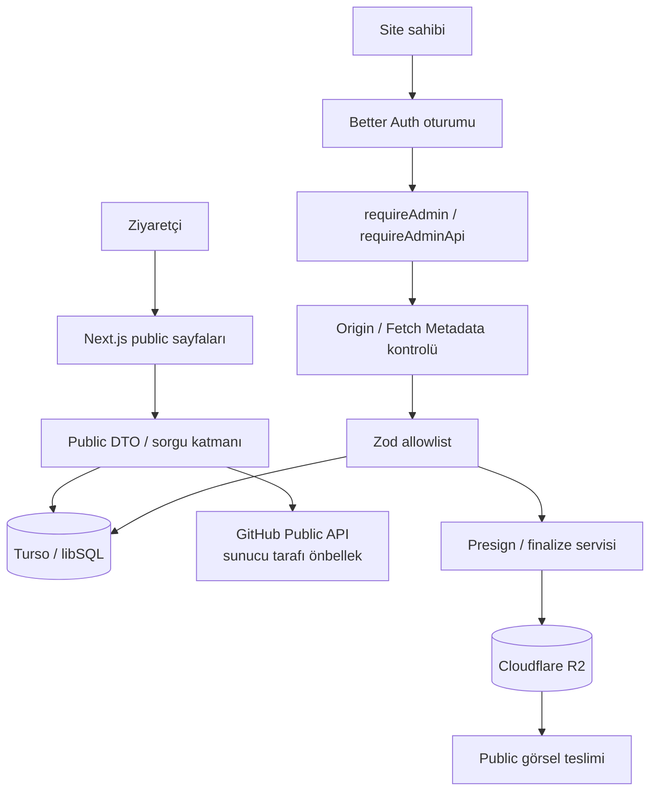
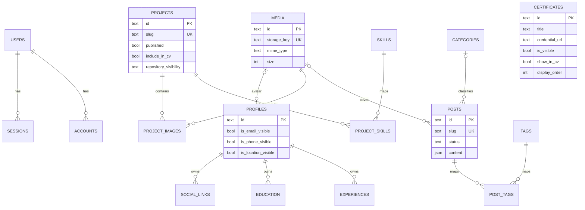
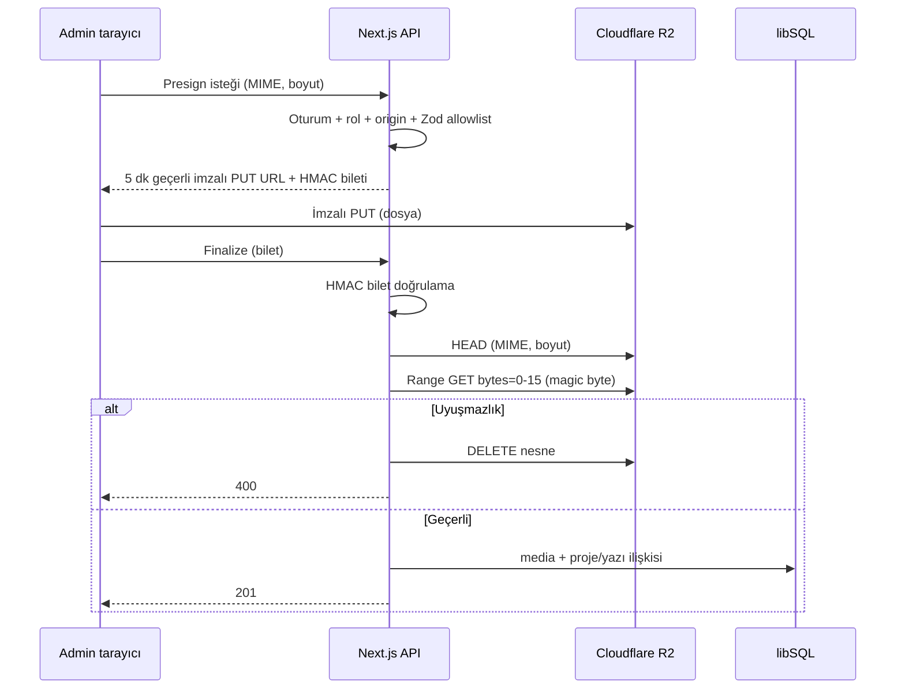

# Kişisel Vitrin, Dinamik Portfolyo ve Kariyer Yönetim Sistemi

**Final Bitirme Projesi Raporu — Sürüm 1.9.0**

> Bu dosya final akademik raporun Markdown kaynak metnidir. Word/PDF çıktısı; içerik gözden geçirildikten, ekran görüntüleri alındıktan ve kişisel/akademik bilgiler doğrulandıktan sonra okulun şablonuna aktarılacaktır. Köşeli parantez içindeki `[Şekil X — …]` işaretleri görsellerin yerini gösterir; gerçek ekran görüntülerinin çoğu `docs/screenshots/` altında alınmıştır, bekleyenler [SCREENSHOT_PLAN](SCREENSHOT_PLAN.md) içinde işaretlidir. Şekil numaraları şablona aktarımda yeniden düzenlenebilir.

---

## Kapak Bilgileri

| Alan | Değer |
| --- | --- |
| Üniversite | Ankara Üniversitesi |
| Meslek Yüksekokulu | Nallıhan Meslek Yüksekokulu |
| Bölüm | Bilgisayar Programcılığı |
| Proje türü | Bitirme Projesi |
| Proje adı | Kişisel Vitrin, Dinamik Portfolyo ve Kariyer Yönetim Sistemi |
| Öğrenci | Mustafa Berk KILIÇASLAN |
| Öğrenci numarası | 25350158 |
| Danışman | Öğr. Gör. Dr. Ufuk TANYERİ |
| Yazılım sürümü | 1.9.0 |

> Okul yazım kılavuzunda istenen onay sayfası, etik beyan, önsöz/teşekkür, içindekiler, şekiller ve tablolar listesi Word şablonunda eklenecektir.

---

## Özet

Bu çalışmada bir yazılım geliştiricinin projelerini, teknik yazılarını, sertifikalarını ve özgeçmiş bilgilerini tek bir yönetim panelinden güncelleyebildiği dinamik bir kişisel portfolyo sistemi geliştirilmiştir. Çıkış noktası, statik portfolyo sitelerinde içerik değişikliğinin kaynak kod düzenlemesi gerektirmesi ve aynı bilginin site, CV ve PDF gibi farklı yerlerde tekrar edilmesidir.

Sistem tek sahipli olarak tasarlanmıştır. İçeriği yalnız site sahibi yönetir; ziyaretçiler hesap açmaz ve içerik üretmez. Bu nedenle proje bir SaaS ürünü değildir. Uygulama Next.js 16.3.8, React 19.2.8 ve TypeScript ile geliştirilmiştir. Veriler Turso/libSQL uyumlu bir veritabanında Drizzle ORM ile tutulur, kimlik doğrulama Better Auth ile sağlanır. Proje görselleri ve blog kapakları Cloudflare R2 üzerinde saklanır. Yönetim panelinden profil, eğitim, deneyim, yetenek, sertifika, proje, blog ve sosyal bağlantılar düzenlenebilir. Web CV ve sunucu tarafında üretilen metin tabanlı PDF CV aynı filtrelenmiş veri kaynağını kullanır. Ziyaretçiye birincil CV olarak yöneticinin yüklediği profesyonel PDF sunulur; yükleme yoksa üretilen PDF yedek olarak devreye girer. Açılış sayfasındaki "Data Spine" görsel anlatısı Three.js, SVG ve Anime.js ile oluşturulmuş, ancak içeriğin kendisi semantik HTML olarak korunmuştur.

Güvenlik; kapalı kayıt, sunucu tarafı rol denetimi, origin kontrolü, hız sınırlama, şema doğrulama, güvenli dosya yükleme, güvenlik başlıkları ve dar public veri nesneleri üzerine kurulmuştur. Geliştirme sırasında yapılan güvenlik denetiminde admin sayfalarında kritik bir veri sızıntısı bulunmuş ve sayfa düzeyinde yetkilendirme ile giderilmiştir. Final sürümde (1.9.0) 131 birim testi, 11 güvenlik birim testi, 140 HTTP regresyon kontrolü ve 16 yüklenen CV HTTP kontrolü başarılıdır; lint, tip denetimi ve production derlemesi temizdir. Production bağımlılık denetimi bulgu vermemiştir. Production deployment henüz yapılmamıştır.

**Anahtar kelimeler:** dinamik portfolyo, içerik yönetim sistemi, web CV, Next.js, web güvenliği, Cloudflare R2

## Abstract

This project presents a dynamic personal portfolio system in which a software developer can manage projects, technical articles, certificates and CV data from a single administration panel. The motivation is that static portfolio websites require source code changes for content updates and repeat the same information across the website, the CV and the PDF version.

The system has a single-owner model. Only the site owner manages content; visitors do not register or create content, so the system is not a SaaS product. The application was built with Next.js 16.3.8, React 19.2.8 and TypeScript. Data is stored in a Turso/libSQL-compatible database through Drizzle ORM, authentication is provided by Better Auth, and project images and blog covers are stored in Cloudflare R2. The web CV and the server-generated, text-based PDF CV are produced from the same filtered data source. Visitors receive a professionally designed PDF uploaded by the administrator as the primary CV; the generated PDF remains as a fallback. The landing page uses a "Data Spine" visual narrative built with Three.js, SVG and Anime.js, while all content remains available as semantic HTML.

The security approach includes disabled public registration, server-side role checks, origin validation, rate limiting, schema validation, secure uploads, security headers and narrow public data objects. During a security review, a critical data exposure in admin pages was discovered and fixed with page-level authorization. In the final version (1.9.0), 131 unit tests, 11 security unit tests, 140 HTTP regression checks and 16 uploaded-CV HTTP checks pass; linting, type checking and the production build succeed, and the production dependency audit reports no findings. Production deployment has not yet been performed.

**Keywords:** dynamic portfolio, content management system, web CV, Next.js, web security, Cloudflare R2

---

## 1. Giriş

Yazılım alanında iş arayan bir kişi için portfolyo, CV kadar önemli bir tanıtım aracıdır. Ancak birçok kişisel site birkaç statik sayfadan oluşur. Yeni bir proje eklemek, bir sertifikayı güncellemek ya da bir yazı yayımlamak için kodu değiştirmek ve siteyi yeniden yayımlamak gerekir. Aynı bilgiler ayrıca bir Word CV'de ve PDF dosyasında da tutulur. Zamanla bu kopyalar birbirinden farklılaşır.

Bu proje, kişisel vitrini ve onu besleyen yönetim panelini tek bir uygulamada birleştirir. İçerik veritabanında tutulur. Ziyaretçiye gösterilen her sayfa, yalnız yayımlanmış ve görünür kayıtlardan sunucu tarafında oluşturulur. Böylece içerik yönetimi, sunum ve gizlilik sınırları birbirinden ayrılır.

Rapor; problemin tanımı, mimari kararlar, modüller, güvenlik yaklaşımı, geliştirme sırasında yaşanan gerçek sorunlar ve test sonuçları sırasıyla ilerler. Projenin tamamlanmış yönleri ile henüz doğrulanmamış deployment adımları ayrı ayrı belirtilmiştir.

## 2. Problem Tanımı

Statik portfolyo yaklaşımında şu sorunlar görülür:

- **İçerik güncelleme maliyeti:** Her değişiklik kod düzenlemesi ve yeniden yayın gerektirir.
- **Veri tekrarı:** Proje, eğitim ve sertifika bilgileri site, CV ve PDF'de ayrı ayrı tutulur.
- **Gizlilik riski:** Taslak bir yazı ya da gizli bir telefon numarası yanlışlıkla yayımlanabilir.
- **Medya düzensizliği:** Görseller kod deposunda ya da rastgele servislerde dağınık durur.
- **Tutarsız CV:** Web'deki bilgiler ile indirilen PDF arasında fark oluşur.

Hazır çok kullanıcılı platformlar bu sorunların bir kısmını çözer. Ancak tek bir kişinin vitrini için gereksiz hesap yönetimi, abonelik ve yetki karmaşıklığı getirir. Ayrıca verinin ve görünümün kontrolü kişide kalmaz.

## 3. Projenin Amacı

Projenin amacı şunlardır:

1. Site sahibinin içeriklerini kod yazmadan, güvenli bir yönetim panelinden güncelleyebilmesi.
2. Proje, blog, sertifika ve kariyer verilerinin tek bir kaynaktan web sitesine, web CV'ye ve PDF CV'ye aktarılması.
3. Gizli veya taslak içeriğin hiçbir koşulda ziyaretçiye ulaşmaması.
4. Ziyaretçiye hızlı, erişilebilir ve akılda kalıcı bir sunum yapılması.
5. Güvenlik ve test disiplininin baştan tasarıma dahil edilmesi.

Bu yönüyle proje, statik bir portfolyodan daha fazlasıdır: veri modeli, yönetim paneli, yetkilendirme, medya altyapısı, CV üretimi ve test altyapısı olan küçük ölçekli bir içerik yönetim sistemidir.

## 4. Kapsam ve Sınırlar

### 4.1 Kapsam

- Public açılış sayfası ve Data Spine görsel anlatısı
- Proje listesi ve vaka çalışması detay sayfaları
- Blog listesi ve yazı detayları
- Sertifikalar, eğitim ve deneyim (Career Timeline)
- Web CV (`/cv`) ve PDF CV (`/api/cv/pdf`); 1.9.0'dan itibaren yöneticinin yüklediği profesyonel PDF birincil CV, üretilen PDF yedektir
- ATS Uyumluluk Kontrolü
- Tek yöneticili admin paneli
- Cloudflare R2 ile görsel yükleme
- GitHub public profil/repository özeti
- Komut paleti (`Ctrl/Cmd+K`) ve sınırlı terminal benzetimi

### 4.2 Neden SaaS değil?

Sistemde kayıt formu yoktur ve kayıt uç noktası sunucu tarafında kapalıdır. Ziyaretçiler yalnız okur. Tek bir site sahibi ve tek bir admin hesabı vardır. Bu nedenle kiracı (tenant) ayrımı, abonelik, kullanıcı başına veri izolasyonu ve faturalama gibi SaaS gereksinimleri kapsam dışıdır.

### 4.3 Neden tek yönetici?

Tek yönetici modeli bilinçli bir tasarım kararıdır:

- **Saldırı yüzeyi küçülür:** Kayıt, parola sıfırlama e-postası ve rol yönetimi ekranları yoktur.
- **Yetkilendirme sadeleşir:** Her admin işlemi "oturum var mı ve rol `admin` mi?" sorusuna indirgenir.
- **Gerçek ihtiyaçla uyumludur:** Kişisel bir vitrinin tek bir sahibi vardır.

İlk admin hesabı yalnız güvenilir terminalde çalışan bir CLI komutuyla oluşturulur. Varsayılan kullanıcı veya varsayılan parola yoktur.

### 4.4 Kapsam dışı bırakılanlar

Çok kullanıcılı hesap modeli, iki adımlı doğrulama (2FA), parola sıfırlama e-postası, CV sürümleme, profil fotoğrafı yükleme ve gerçek bir işveren ATS sistemiyle entegrasyon kapsam dışındadır. Production deployment kullanıcı kararıyla ertelenmiştir (bkz. Bölüm 31).

## 5. Gereksinim Analizi

### 5.1 İşlevsel gereksinimler

- Yönetici güvenli biçimde oturum açabilmeli; her işlem sunucuda yetkilendirilmelidir.
- Profil, eğitim, deneyim, yetenek, sertifika, proje, yazı, kategori, etiket, CV ayarı ve sosyal bağlantılar yönetilebilmelidir.
- Taslak ve gizli içerik public yanıtlara taşınmamalıdır.
- Web CV ve üretilen PDF CV aynı public veri kaynağından üretilmelidir.
- Yönetici profesyonel bir CV PDF'i yükleyebilmeli; ziyaretçinin "CV" bağlantısı bu PDF'i açmalı, yükleme yoksa üretilen PDF'e düşmelidir (1.9.0).
- Görseller uygulama sunucusu üzerinden taşınmadan, doğrulanmış bir akışla yüklenmelidir.

### 5.2 İşlevsel olmayan gereksinimler

- TypeScript strict tip denetimi, şema doğrulama ve sürümlenmiş migration kullanılmalıdır.
- Ağır görsel katmanlar yalnız gereken sayfada ve gecikmeli yüklenmelidir.
- Public veri en dar biçimde sunulmalı; secret ve özel alanlar istemciye gönderilmemelidir.
- Sistem klavye ile kullanılabilmeli ve azaltılmış hareket tercihine uymalıdır.
- Testler tekrar çalıştırılabilir olmalı ve gerçek veritabanına dokunmamalıdır.

## 6. Kullanılan Teknolojiler

| Teknoloji | Kullanım amacı | Seçilme nedeni |
| --- | --- | --- |
| Next.js 16.3.8 | App Router, Server Components, Route Handler | Public ve admin yüzeyini aynı projede, sunucu öncelikli kurmak |
| React 19.2.8 | Bileşen tabanlı arayüz | Yeniden kullanılabilir, erişilebilir UI |
| TypeScript | Tip güvenliği | Hataları derleme öncesi yakalamak, veri sınırlarını görünür kılmak |
| Tailwind CSS 4 | Responsive stil ve tasarım token'ları | Ek UI kütüphanesi olmadan tutarlı stil |
| Turso / libSQL | İlişkisel veritabanı | SQLite uyumlu; yerelde dosya, ileride yönetilen bulut veritabanı |
| Drizzle ORM | Şema, sorgu, migration | Tip güvenli ve parametreli sorgu, sürümlenmiş migration |
| Better Auth | Oturum ve admin rolü | Uygulama içinde çalışır; kayıt kapatılabilir, Drizzle ile uyumlu |
| Cloudflare R2 | Görsel depolama | S3 uyumlu API, presigned yükleme, düşük çıkış maliyeti |
| Tiptap | Blog editörü | İçeriği HTML yerine yapısal JSON olarak üretir |
| @react-pdf/renderer | PDF CV | Sunucu tarafında, seçilebilir metinli PDF |
| Anime.js | DOM hareketleri | Küçük, merkezi ve reduced-motion ile kontrol edilebilir |
| Three.js | Data Spine ve Skill Universe | Texture gerektirmeyen prosedürel 3B katman |
| Zod | Girdi doğrulama | Allowlist, normalizasyon ve anlaşılır hata mesajları |

**Supabase neden seçilmedi?** Supabase güçlü bir platformdur; ancak PostgreSQL, kendi auth ve storage servisleriyle birlikte gelir. Tek yöneticili bir kişisel proje için bu ek servisler ihtiyaç dışı operasyon yükü yaratır. Turso/libSQL, yerelde tek bir dosya ile çalışabildiği için geliştirme ve test ortamını basitleştirmiştir.

## 7. Sistem Mimarisi

Sistem, public okuma ve admin yazma akışlarını iki ayrı güven sınırında ele alır.

- **Public akış:** Ziyaretçi isteği Next.js sunucu bileşenlerine gelir. Sorgu katmanı yalnız görünür ve yayımlanmış kayıtları seçer ve dar bir veri nesnesi (DTO) üretir.
- **Admin akış:** Her istek oturum, rol, origin ve şema doğrulamasından geçer. Ancak ondan sonra veritabanına veya R2'ye ulaşır.
- **Secret sınırı:** Veritabanı token'ı, auth secret'ı ve R2 anahtarları yalnız sunucuda okunur. Hiçbirinde `NEXT_PUBLIC_` öneki yoktur.



[Şekil 1 — Sistem mimarisi diyagramı]

Kod yapısı katmanlara ayrılmıştır: `src/app` rotaları ve sayfaları, `src/components` arayüzü, `src/features` saf iş kurallarını ve doğrulama şemalarını, `src/server` repository, auth ve depolama kodunu, `src/db` ise şema ve veritabanı istemcisini içerir. Saf kurallar sunucu kodundan ayrıldığı için birim testleri veritabanı olmadan çalışabilir.

## 8. Veritabanı Tasarımı

Veritabanı 21 uygulama tablosundan oluşur. Beşi Better Auth'a (`users`, `sessions`, `accounts`, `verifications`, `rate_limits`), on altısı içeriğe aittir. Şema beş sürümlenmiş migration ile oluşturulmuştur: temel tablolar, CV alanları, telefon ve CV sosyal görünürlük alanları, sertifikalar ve (1.9.0) `cv_settings` üzerindeki yüklenen profesyonel CV meta verisi.

Tasarımda şu ilkeler uygulanmıştır:

- **Görünürlük veride tutulur:** `is_visible`, `show_in_cv`, `published`, `status` gibi alanlar her içerik türünde vardır.
- **Medya içerikten ayrıdır:** `media` tablosu fiziksel nesne bilgisini (anahtar, MIME, boyut) tutar; proje ve yazılar bu kayda referans verir.
- **Çoka çok ilişkiler birleşim tablosuyla:** proje–yetenek (`project_skills`) ve yazı–etiket (`post_tags`).
- **Tekil ayarlar:** `profiles`, `cv_settings` ve `site_settings` tek kayıtlı yapılardır.
- **Veritabanı kısıtları:** Benzersiz slug'lar ve sertifikada "bitiş tarihi veriliş tarihinden önce olamaz" CHECK kısıtı.



[Şekil 2 — Final ER diyagramı]

`CERTIFICATES`, `CV_SETTINGS`, `SITE_SETTINGS`, `VERIFICATIONS` ve `RATE_LIMITS` bağımsız yapılardır; diyagramda bu tablolar için hayali yabancı anahtar çizilmemiştir.

## 9. Kimlik Doğrulama ve Admin Paneli

### 9.1 Kimlik doğrulama

Better Auth e-posta/parola oturumunu yönetir. Parola 12–128 karakter olmalıdır ve Better Auth'ın varsayılan scrypt özetleme yöntemiyle saklanır. Oturum veritabanında tutulur, yedi gün geçerlidir ve günde bir yenilenir. Public kayıt (`disableSignUp`) sunucu tarafında kapalıdır; kayıt uç noktası rol alanıyla çağrılsa bile `400` döner.

İlk yönetici `npm run auth:bootstrap` komutuyla oluşturulur. Komut parolayı gizli terminal girişinden ister ve ekrana yazdırmaz.

### 9.2 Yetkilendirme

Yetkilendirme iki yardımcı fonksiyonla yapılır:

- `requireAdmin()` admin sayfalarında kullanılır; oturum yoksa giriş sayfasına yönlendirir.
- `requireAdminApi()` admin API'lerinde kullanılır; oturum ve rolün yanında isteğin origin'ini de kontrol eder, başarısızlıkta `401` döner.

1.9.0 itibarıyla 15 korumalı admin sayfasının tamamı ve 34 route dosyasındaki 43 admin API handler'ının tamamı (1.9.0'da eklenen 3 profesyonel CV handler'ı dahil) bu kontrolleri, gövde okumadan ve veri çekmeden önce yapar. Sayfa düzeyindeki kontrolün neden zorunlu olduğu Bölüm 23'te anlatılmıştır.

### 9.3 Admin paneli

Panel; Dashboard, Projects, Blog, Profile, Social, Education, Experience, Certificates, Skills ve CV ekranlarından oluşur. Formlar sunucuya JSON gönderir. İstemciden gelen nesne doğrudan veritabanına yazılmaz; Zod şemasında izin verilen alanlar seçilir ve repository katmanında tek tek eşlenir.

[Şekil 3 — Admin Dashboard]

## 10. Proje Yönetim Modülü

Bir proje kaydı başlık, slug, kısa ve uzun açıklama, problem, çözüm, rol, mimari açıklama, durum, tarihler, canlı bağlantı, repository bağlantısı ve görünürlüğü, öne çıkarma, yayın ve CV'ye dahil etme alanlarından oluşur. Projeye ortak yetenek kataloğundan teknoloji bağlanır. Her projeye bir kapak ve sıralanabilir galeri görselleri eklenebilir.

Public sorgular yalnız `published = true` kayıtları döndürür. Repository görünürlüğü `private` ise bağlantı public veri nesnesine hiç girmez; ziyaretçi yalnız "Özel depo" etiketini görür. Türkçe başlıklar güvenli slug'a dönüştürülür (örneğin "Çalışma Örneği" → `calisma-ornegi`).

[Şekil 4 — Project CMS (admin proje düzenleme)]

[Şekil 5 — Public proje detayı / vaka çalışması]

## 11. Blog Yönetim Modülü

Blog modülü Tiptap editörü, kategori, etiket, kapak görseli, taslak/yayın durumu ve SEO başlık/açıklama alanlarını içerir. Taslak yazılar listede görünmez; doğrudan adresle açılmak istendiğinde `404` döner.

### 11.1 Neden HTML yerine Tiptap JSON?

Zengin metin, web uygulamalarında en sık XSS kaynaklarından biridir. Editörden gelen içerik HTML olarak saklanıp sayfaya basılsaydı, araya girmiş bir `<script>` etiketi veya `javascript:` bağlantısı ziyaretçinin tarayıcısında çalışabilirdi.

Bu nedenle içerik, Tiptap'in yapısal JSON biçiminde saklanır:

- Sunucu yalnız izin verilen düğüm ve işaret türlerini kabul eder (paragraf, başlık, liste, kod bloğu, bağlantı vb.).
- Bağlantılarda yalnız `http:`, `https:` ve `mailto:` kabul edilir; `javascript:`, `data:` ve `vbscript:` reddedilir.
- Düğüm sayısı, metin uzunluğu ve toplam boyut sınırlandırılmıştır.
- Public tarafta JSON, elle yazılmış bir React renderer ile elemanlara çevrilir. `dangerouslySetInnerHTML` kullanılmaz.

Böylece güvenlik, "zararlı HTML'i temizlemeye" değil, "yalnız bilinen yapıyı kabul etmeye" dayanır.

[Şekil 6 — Blog CMS (Tiptap editörü)]

## 12. Profil, Eğitim, Deneyim ve Yetenek Yönetimi

Profil kaydı ad, unvan, kısa ve uzun biyografi, e-posta, telefon, konum ve bunların görünürlük bayraklarını içerir. Kısa biyografi açılış sayfasında, uzun biyografi "Hakkımda" bölümünde ve CV özetinde kullanılır.

Eğitim ve deneyim kayıtları başlangıç/bitiş tarihi ve "devam ediyor" bilgisi taşır. Sunucu iki tutarsızlığı reddeder: devam eden kayıtta bitiş tarihi olması ve bitiş tarihinin başlangıçtan önce olması. Career Timeline yalnız eğitim ve deneyimi tarih sırasıyla gösterir; projeler ayrı vitrinde kalır.

Yetenekler kategori ve görünürlük bilgisi taşır. Görünür yetenekler hem CV'de hem de Skill Universe'te gösterilir. Bir yetenek silinirse proje bağlantıları da kaldırılır; arayüz bu etkiyi silmeden önce kullanıcıya açıkça söyler.

## 13. Sertifika Yönetimi

Sertifika modülü 1.8.0 sürümünde eklenmiştir. Yalnız sertifika adı zorunludur. Kurum, eğitmen, veriliş ve bitiş tarihi, kimlik numarası, doğrulama bağlantısı ve açıklama isteğe bağlıdır.

Her sertifikanın iki bağımsız bayrağı vardır:

- **Web Sitesinde Göster (`is_visible`):** Kayıt açılış sayfasında görünür.
- **CV'de Göster (`show_in_cv`):** Kayıt web CV'de ve PDF CV'de görünür.

Bir sertifikanın CV'de çıkması için iki bayrağın da açık olması gerekir. Bu filtre SQL sorgusunun `WHERE` koşulunda uygulanır. Böylece gizli bir sertifika ne HTML'e, ne RSC verisine, ne de PDF'e ulaşır. Sıra, admin panelindeki yukarı/aşağı kontrolleriyle değiştirilir ve web ile CV'de aynı sıra kullanılır.

Doğrulama bağlantısı yalnız kimlik bilgisi içermeyen `https:` adresi olabilir. Bağlantı kayıt sırasında doğrulanır, public okumada bir kez daha süzülür. Böylece eski veya elle girilmiş hatalı bir kayıt da yayına çıkamaz.

[Şekil 7 — Certificates Admin]

[Şekil 8 — Public Certificates (Data Spine üzerinde)]

## 14. Web CV

`/cv` sayfası profil, eğitim, deneyim, yetenek, sertifika, seçilmiş projeler ve CV'de gösterilecek sosyal bağlantılardan oluşur. Yönetici bölüm sırasını, bölüm görünürlüğünü, CV başlığını ve gösterilecek en fazla proje sayısını belirleyebilir.

### 14.1 Neden sunucu tarafında filtreleme?

Gizli bir e-postayı CSS ile (`display: none`) gizlemek gizlilik sağlamaz. Bilgi HTML kaynağında ve React'in istemciye gönderdiği RSC verisinde yine bulunur. Sayfa kaynağını görüntüleyen, metni kopyalayan ya da bir arama motoru botu bu bilgiye ulaşır.

Bu projede gizlilik, yanıt oluşturulmadan önce `getPublicCvData()` içinde uygulanır:

```text
profiles (ham satır, yalnız sunucuda)
  → isEmailVisible    ? email    : null
  → isLocationVisible ? location : null
  → isPhoneVisible    ? phone    : null
  → sosyal bağlantılar: isVisible && showInCv, yalnız HTTPS
  → projeler: published && includeInCv
  → sertifikalar: isVisible && showInCv
PublicCvData
  ├─ /cv (HTML)
  ├─ /api/cv/pdf (PDF)
  └─ ATS Uyumluluk Kontrolü
```

Gizli alan veri nesnesinde hiç üretilmediği için istemciye, PDF'e veya React prop'larına ulaşamaz.

### 14.2 Neden hem Web CV hem PDF CV?

1.9.0'dan itibaren ziyaretçinin "CV" bağlantısı yöneticinin yüklediği profesyonel PDF'i açar (Bölüm 15.3); aşağıdaki gerekçe Web CV ile yedek rolündeki üretilen PDF için geçerliliğini korur. İki çıktının amacı farklıdır. Web CV, bağlantıları tıklanabilir, her cihazda okunabilir ve her zaman günceldir. PDF CV ise iş başvurularında dosya olarak yüklenir veya e-postayla gönderilir. İkisinin aynı veri nesnesinden üretilmesi, sahibin bilgiyi bir kez güncellemesini ve iki çıktının hiçbir zaman çelişmemesini sağlar.

[Şekil 9 — Web CV]

## 15. PDF CV ve ATS Yaklaşımı

### 15.1 PDF üretimi

`GET /api/cv/pdf` uç noktası `@react-pdf/renderer` ile sunucu tarafında A4, tek kolonlu bir PDF üretir. Türkçe karakterler için yerel ve OFL lisanslı Noto Sans Regular/Bold yazı tipi gömülür. Metin görsele dönüştürülmez; seçilebilir ve aranabilir kalır. Yanıt `Cache-Control: no-store` ile döner ve dosya adı yalnız `[a-z0-9-]` karakterlerinden oluşur.

Otomatik testler PDF'in `%PDF` imzasını, metin çıkarımıyla Türkçe karakterleri ve görünür alanları, gizli alanların ise bulunmadığını doğrular. Bu testin önemli bir dersi olmuştur: PDF'in ekranda doğru görünmesi, metnin makine tarafından okunabildiğini kanıtlamaz.

**Sayfalama düzeltmesi (1.8.4).** Mevcut içerikle PDF CV önceden 3 sayfa üretiyordu. Bu, içerik fazlalığı değil bir sayfalama hatasıydı: sayfa 1'de Eğitim'den sonra büyük bir boşluk kalıyor, Sertifikalar bölümü bütünüyle sayfa 2'ye geçiyor ve son deneyim açıklamasının iki satırı tek başına sayfa 3'e düşüyordu. Kök neden, `@react-pdf/renderer`'ın sayfalama motorunun iki davranışıydı: sığan bir bloğun alt boşluğunu da "sığıyor mu" hesabına katması ve "birlikte tut" kararlarını yalnız aynı kapsayıcıdaki kardeş elemanlar arasında uygulaması. Bölümler sayfa düzeyinde ayrı bloklara çevrildi: başlık ilk öğeyle birlikte bölünmez bir blok oldu, her öğe kendi içinde bölünmez hâle geldi ve boşluklar yalnız üst kenar boşluğuyla verildi. Font küçültülmedi. Mevcut veriyle PDF artık 2 sayfadır. Tek kolonlu, sade ve metin tabanlı ATS yapısı, Noto Sans ile Türkçe karakter desteği ve bağlantılar korunmuştur. Gerilemeyi önlemek için sayfa sınırlarını geçen verilerle çalışan bir HTTP testi eklenmiştir; test eski kodda başarısız olmaktadır.

### 15.2 ATS Uyumluluk Kontrolü

ATS (Applicant Tracking System), şirketlerin başvuruları ayrıştırıp filtrelediği yazılımlardır. Çok kolonlu, görsel ağırlıklı veya metni resim olarak içeren CV'ler bu sistemlerde hatalı okunabilir. Bu yüzden PDF CV tek kolonlu, standart başlıklı ve metin tabanlıdır.

Projedeki ATS Uyumluluk Kontrolü gerçek bir işveren ATS'sinin sonucunu taklit etmez. Ad soyad, unvan, e-posta görünürlüğü, özet uzunluğu, yetenek sayısı, eğitim, tarih tutarlılığı, CV projesi ve standart başlıklar gibi açıklanabilir kuralları değerlendirir. Her kuralın ağırlığı vardır; `pass = 1`, `warning = 0,5`, `fail = 0` kredi alır:

`puan = yuvarla(Σ(ağırlık × kredi) / Σ(uygulanabilir ağırlık) × 100)`

Sonuç aynı veri için her zaman aynıdır ve yöneticiye düzeltme önerisi sunar. Puan, işe alınma olasılığı olarak yorumlanmamalıdır.

### 15.3 Ürün iyileştirmesi: yüklenen profesyonel CV (1.9.0)

1.8.4 sürümünde sistemin CV hattı şuydu: yapılandırılmış profil, eğitim, deneyim, yetenek ve sertifika verisi → Web CV → sunucu tarafında üretilen ATS odaklı PDF CV. Bu hat teknik olarak çalışıyordu ve korunmuştur. Ancak site sahibinin ayrıca hazırladığı, profesyonel tasarımlı bir CV PDF'i, otomatik üretilen PDF'ten belirgin biçimde daha iyi görünüyordu. Ziyaretçinin "CV" bağlantısında görmesi gereken belge buydu.

1.9.0 ile yönetici, admin CV sayfasındaki **Profesyonel CV PDF** bölümünden bir PDF yükleyebilir, değiştirebilir veya kaldırabilir. Yüklenen PDF **birincil public CV** olur. Üretilen PDF silinmemiştir; **teknik yedek** olarak kalır:

```text
Ziyaretçi "CV" → GET /api/cv/pdf
  ├─ aktif yüklenmiş PDF var ve R2'den doğrulanarak okunabiliyor → yüklenen profesyonel PDF
  └─ yoksa (veya depolama erişilemezse)                         → PublicCvData'dan üretilen PDF
```

Tasarım gerekçesi:

- Yapılandırılmış veri web sunumu ve `/cv` Web CV için değerini korur; ATS kontrolü veri kalitesi aracı olarak kalır.
- Üretilen PDF, yükleme yokken veya depolama geçici olarak erişilemezken CV bağlantısının kırılmamasını sağlar.
- Kullanıcının hazırladığı profesyonel PDF daha iyi sunum kalitesi verir.
- Dosya yalnız yöneticinin kontrolündedir ve public bağlantı (`/api/cv/pdf`) değişmemiştir; eski bağlantılar çalışmaya devam eder.

PDF, Bölüm 18'deki güvenli yükleme akışıyla R2'ye yüklenir. Sunucu, tarayıcının bildirdiği türe güvenmez: finalize aşamasında nesnenin MIME türünü, boyutunu (en fazla 5 MB, bilette beklenenle aynı) ve ilk baytlarındaki `%PDF-` imzasını doğrular. HTML, SVG veya görsel dosyalarının adı `.pdf` yapılsa bile reddedilir. Doğrulanan nesne değiştirilemez bir `cv/<uuid>.pdf` anahtarıyla saklanır; aktif CV veritabanında tek bir işlemle yeni nesneye geçirilir, eski nesne ancak bu geçişten sonra silinir. Başarısız bir yükleme aktif CV'yi bozmaz. Public yanıt PDF'i R2'den sunucu tarafında okuyup aynı origin üzerinden verir. Ham depolama adresi ve imzalı URL public'e verilmez, dosya adı ise sabittir (`mustafa-berk-kilicaslan-cv.pdf`). Bu yaklaşım Bölüm 24'teki `r2.dev` erişim sorununa da bağımlı değildir.

Karar ADR-095 olarak kayıt altındadır.

[Şekil 10 — Yüklenen profesyonel PDF CV, `/api/cv/pdf` üzerinden tarayıcıda açılmış hâli]

[Şekil 10b — Admin "Profesyonel CV PDF" bölümü, durum: Yüklendi]

[Şekil 11 — ATS Uyumluluk Kontrolü]

## 16. Sosyal Bağlantılar ve İletişim

Admin sosyal bağlantı ekleyebilir, düzenleyebilir, silebilir, sıralayabilir ve görünürlüğünü değiştirebilir. GitHub, LinkedIn, kişisel site, Instagram, Behance ve Dribbble gibi platformlar desteklenir. URL yalnız kimlik bilgisi içermeyen `https:` olabilir. GitHub platformu için repository değil profil adresi istenir.

Geliştirme sırasında önemli bir bulgu yaşanmıştır: React `javascript:` bağlantısını çalıştırmasa da, zararlı URL public veri nesnesinde taşınıyordu. Çözüm, public sorguda HTTPS allowlist uygulamak oldu. Ders: render güvenliği, veri minimizasyonunun yerine geçmez.

Telefon numarası güvenli `tel:` biçimine normalize edilir ve yalnız görünürlük bayrağı açıksa İletişim bölümüne ve CV'ye çıkar.

## 17. GitHub Entegrasyonu

GitHub kullanıcı adı, görünür GitHub sosyal bağlantısından veya sunucuya özel `GITHUB_USERNAME` değişkeninden alınır. GitHub Public API yanıtı Zod ile daraltılır. Fork, arşivlenmiş ve CMS'de private işaretli repository'ler gösterilmez. Veri sunucu tarafında altı saat önbelleğe alınır, istek zaman aşımına sahiptir. API'ye ulaşılamazsa yalnız profil bağlantısı gösterilir. İsteğe bağlı `GITHUB_TOKEN` istemci paketine girmez.

## 18. Cloudflare R2 Medya Yönetimi

### 18.1 Yükleme akışı

Görsel dosyaları uygulama sunucusundan geçirilmez. Tarayıcı dosyayı doğrudan R2'ye yükler, ancak sunucu yüklemenin her adımını denetler:



[Şekil 12 — R2 yükleme akışı diyagramı]

Adımlar:

1. **Presign:** Admin MIME türü ve boyutu bildirir. Sunucu kimliği, rolü, origin'i ve allowlist'i doğrular. Nesne anahtarını kendisi üretir: `projects/<proje-uuid>/<rastgele-uuid>.webp`. Kullanıcının dosya adı kullanılmaz, bu da yol geçişini (path traversal) ve çakışmayı önler.
2. **İmzalı PUT:** Tarayıcı 5 dakika geçerli URL ile dosyayı doğrudan R2'ye gönderir. İmza `Content-Type` değerini de kapsar.
3. **Finalize:** Sunucu HMAC-SHA256 ile imzalanmış bileti doğrular. Bilet; kapsamı, kaynak kimliğini, anahtarı, MIME türünü, beklenen boyutu ve son kullanma zamanını bağlar.
4. **Doğrulama:** `HEAD` ile gerçek MIME türü ve boyut kontrol edilir. Ardından nesnenin ilk 16 baytı okunur ve dosya imzası (magic byte) bildirilen türle karşılaştırılır.
5. **Kayıt:** Her şey uyuşursa `media` kaydı ve proje/yazı ilişkisi oluşturulur. Uyuşmazlıkta nesne silinir ve veritabanına kayıt yazılmaz.
6. **Gösterim:** Public sayfa görseli R2 public adresinden `next/image` ile gösterir.

### 18.2 Kabul edilen ve reddedilen dosyalar

| Tür | Durum | Neden |
| --- | --- | --- |
| JPEG, PNG, WebP | Kabul | Yaygın, güvenli raster formatlar |
| SVG | Red | İçinde script barındırabilir; XSS riski |
| GIF | Red | Kapsam dışı; animasyon ve boyut sorunları |
| 5 MB üstü | Red | Depolama ve performans sınırı |

### 18.3 Neden magic-byte doğrulaması?

Tarayıcının bildirdiği MIME türü ve dosya uzantısı istemci tarafından kolayca değiştirilebilir. Örneğin bir HTML dosyası `photo.jpg` adıyla ve `image/jpeg` başlığıyla gönderilebilir. Magic byte, dosyanın içeriğinin ilk baytlarıdır: JPEG `FF D8 FF`, PNG `89 50 4E 47 …`, WebP ise `RIFF … WEBP` ile başlar. Sunucu bu baytları gerçek nesneden okuduğu için bildirilen tür ile içerik arasındaki uyuşmazlığı yakalar.

### 18.4 Gerçek ortam doğrulaması

1.8.3 sürümünde R2 gerçek bir bucket ile yapılandırılmış ve yerel ortamdan uçtan uca test edilmiştir. Proje görseli ve blog kapağı yükleme, admin önizleme ve public proje/blog sayfasında görüntüleme çalışmaktadır. JPEG/PNG/WebP kabul edilmiş, SVG/GIF ve 5 MB üstü dosyalar reddedilmiş, magic-byte doğrulaması çalışmış ve oturumsuz presign isteği reddedilmiştir. R2 anahtarları yalnız sunucuda kalmıştır.

Public erişim şu an Cloudflare'in `r2.dev` adresi üzerindendir. Cloudflare bu adresi geliştirme ve test amaçlı tanımlar. Production için bir özel medya alt alan adı (custom domain) kullanılması planlanmıştır ve bu adım deployment çalışmasının parçasıdır.

[Şekil 13 — R2 Upload (admin medya alanı)]

### 18.5 Profesyonel CV PDF'i için aynı akış (1.9.0)

Yüklenen profesyonel CV (Bölüm 15.3) görsellerle aynı presign → imzalı PUT → finalize akışını kullanır; görsel doğrulaması değiştirilmemiştir. Farklar şunlardır:

| | Görsel | Profesyonel CV |
| --- | --- | --- |
| Kabul | JPEG / PNG / WebP | Yalnız `application/pdf` |
| İmza kontrolü | JPEG/PNG/WebP magic byte | İlk baytlar `%PDF-` |
| Anahtar | `projects/<uuid>/<uuid>.<uzantı>` veya `blog/<uuid>/<uuid>.<uzantı>` | `cv/<uuid>.pdf` (değiştirilemez) |
| Bilet | Görsel bileti | Ayrı şema, alan-ayrımlı HMAC (`cv-upload:`) |
| Kayıt | `media` + ilişki | `cv_settings` tekil satırındaki 4 kolon |
| Public teslim | R2 public adresi | `/api/cv/pdf` üzerinden sunucu tarafında, aynı origin |

Yeni nesne doğrulandıktan sonra aktif CV tek bir veritabanı işlemiyle değiştirilir. Eski nesne ancak bu işlemden sonra en iyi çaba (best-effort) ile silinir. Silme başarısız olsa da aktif CV çalışır; doğrulamadan geçemeyen yeni nesne ise silinir ve aktif CV'ye dokunulmaz.

## 19. Data Spine ve Görsel Deneyim

### 19.1 Tasarım fikri

Açılış sayfası, birbirinden kopuk bölümler yerine tek bir görsel omurga etrafında kurulmuştur. "Data Spine" (veri omurgası), Hero'dan İletişim'e kadar sayfa boyunca kesintisiz uzanan tek bir rotadır. Projeler, eğitim, sertifikalar, blog, CV, GitHub ve İletişim bölümleri bu omurgaya bağlanan duraklardır (hub). Fikir, bir geliştiricinin kariyerini birbirine bağlı veri noktaları olarak anlatmaktır.

Tasarım birkaç sürümde evrilmiştir. İlk denemede her bölümde omurganın farklı bir pozu vardı; kullanıcı bunu "her bölümün ayrı bir omurgası var" diye algıladı. 1.4.0 sürümünde tek ve sürekli rota modeline geçildi. 1.6.0 ve 1.7.0 sürümlerinde ise dallar ve içerik kartları sırayla açılan "pinned" sahnelere dönüştürüldü.

### 19.2 Nasıl çalışır?

- Her bölüm, omurganın geçeceği şeridi ve durağı DOM üzerinde işaretler.
- Rota, bu ölçülen noktalardan geçen tek bir Catmull-Rom spline eğrisidir.
- Scroll ilerledikçe beyaz bir "core" rota boyunca hareket eder ve ilgili durağa ulaşır.
- Core durağa ulaşınca sahne sabitlenir (sticky). Dallar duraktan çizilir ve kartlar sırayla görünür.
- Sıra tamamlanınca sahne serbest bırakılır. Geri scroll aynı adımları tersine çevirir.
- Sağdaki ilerleme göstergesi core ile senkron çalışır.

Sabitleme, tarayıcının yerel `position: sticky` davranışıyla yapılır. Scroll olayı ele geçirilmez; klavye, Page Down ve Space gibi doğal scroll yöntemleri çalışmaya devam eder.

### 19.3 Animasyon, semantik HTML'in yerine geçmez

Data Spine tamamen dekoratiftir. Canvas ve SVG katmanları `aria-hidden="true"` ve `pointer-events: none` ile işaretlenmiştir. Tüm başlıklar, kartlar, bağlantılar ve metinler gerçek HTML olarak sunucuda üretilir. Bu sayede:

- Ekran okuyucu kullanan bir ziyaretçi içeriğe animasyondan bağımsız ulaşır.
- Arama motorları metni okuyabilir.
- WebGL desteklenmezse veya JavaScript geç yüklenirse içerik yine görünür.
- İletişim bağlantıları omurganın üzerinde kalır ve tıklanabilir.

[Şekil 14 — Hero / Data Spine]

## 20. Anime.js ve Three.js Kullanımı

**Three.js**, Data Spine'ın 3B katmanını ve Skill Universe'ü çizer. Her ikisi de vanilla Three.js ile prosedürel olarak oluşturulur; dış model, ağır texture veya post-processing kullanılmaz. Data Spine tek bir sabit WebGL canvas'ı ile çizilir. WebGL2 desteklenmiyorsa renderer oluşturulmaz ve CSS/SVG katmanı tek başına çalışır.

**Anime.js**, DOM tarafındaki reveal ve geçiş hareketleri için kullanılır. Hareket mantığı merkezi tutulmuştur ve aynı reduced-motion kararına bağlıdır.

**Skill Universe**, görünür yetenekleri kategori ve proje ilişkileriyle bir ağ olarak gösterir. Aynı bilgi gerçek HTML listesi olarak da sunulur.

**Komut paleti ve terminal:** `Ctrl/Cmd+K` ile açılan palet sayfaları, projeleri, yazıları ve CV'yi arar. Terminal gerçek bir kabuk değildir; sabit bir komut listesi (`help`, `projects`, `cv` vb.) çalıştırır. `eval`, `Function` veya ağ isteği yoktur.

### 20.1 Azaltılmış hareket ve yedek davranışlar

- İşletim sistemindeki `prefers-reduced-motion: reduce` tercihi okunur.
- Ayrıca sayfada bir "hareketi azalt" anahtarı vardır.
- Reduced-motion etkinken kalite kademesi `static` olur: sahne sabitlenmez, ekstra scroll mesafesi eklenmez, tüm kartlar baştan görünür ve core en yakın durakta durur.
- Kısa ekranlarda veya içeriği ekrana sığmayan bölümlerde sabitleme otomatik olarak devre dışı kalır ve bölüm normal akışa geçer.

## 21. Responsive Tasarım ve Erişilebilirlik

Arayüz mobil öncelikli olarak tasarlanmıştır. Masaüstünde omurga ortadan zikzak çizerken, 56rem altındaki ekranlarda sol kenardaki dar bir şeride taşınır ve içerikler kısa dallarla bağlanır. 375 ve 390 CSS piksel genişliklerinde yatay taşma olmadığı tarayıcıda doğrulanmıştır.

Uygulanan erişilebilirlik önlemleri:

- Semantik başlık hiyerarşisi ve `lang="tr"`
- İçeriğe atla bağlantısı (skip link) ve görünür odak göstergesi
- Klavye ile tam gezinme; mobil menüde `aria-expanded` ve Escape ile kapanma
- Aktif sayfada `aria-current`
- Komut paleti ve terminalde yerel `dialog`, odak tuzağı ve odağın geri verilmesi
- Görsellerde zorunlu alternatif metin
- Dekoratif katmanlarda `aria-hidden`

Gerçek ekran okuyucu (NVDA/VoiceOver) ve fiziksel cihaz testi yapılmamıştır (bkz. Bölüm 31).

[Şekil 15 — Mobile View (375/390 CSS px)]

## 22. Güvenlik Yaklaşımı

Güvenlik, sonradan eklenen bir katman olarak değil, her modülün tasarımına dahil edilerek ele alınmıştır. Aşağıdaki önlemler riski azaltır; sistemin "hacklenemez" veya "%100 güvenli" olduğu iddia edilmez. Biçimsel bir penetrasyon testi yapılmamıştır. Doğrulamalar otomatik testler, kod incelemesi ve proje içinde yapılan güvenlik denetimiyle sınırlıdır.

### 22.1 Kimlik doğrulama ve yetkilendirme

- Parolalar scrypt ile özetlenir; düz metin parola kaynakta veya migration'da yoktur.
- Public kayıt sunucu tarafında kapalıdır.
- Rol yükseltme engellidir: oturum açmış admin bile `update-user` ile rol alanı gönderirse `400 FIELD_NOT_ALLOWED` alır.
- Her admin sayfası `requireAdmin()`, her admin API'si `requireAdminApi()` çağırır.
- Giriş hatalarında tek bir genel mesaj gösterilir; hangi alanın hatalı olduğu söylenmez.

### 22.2 Hız sınırlama (rate limiting)

Better Auth'ın veritabanı tabanlı hız sınırlayıcısı kullanılır. Genel sınır 60 saniyede 60 istektir. E-posta ile giriş için sınır 60 saniyede 5 istektir. Testte ardışık hatalı denemeler `401, 401, 401, 401, 429, 429` yanıtlarını üretmiştir. Sayaç veritabanında tutulduğu için sunucu yeniden başlasa da sıfırlanmaz.

### 22.3 CSRF ve origin koruması

CSRF (Cross-Site Request Forgery), kullanıcının oturumu açıkken başka bir sitenin onun adına istek göndermesidir. Korumalar katmanlıdır:

- Oturum çerezi `HttpOnly` ve `SameSite=Lax`'tır; başka sitelerden gelen POST/PUT/DELETE isteklerine eklenmez.
- Admin API'leri `Origin` başlığının birebir `BETTER_AUTH_URL` olmasını ister. `Origin` yoksa tarayıcının `Sec-Fetch-Site` başlığı `cross-site` olan istekleri reddedilir.
- Better Auth uç noktalarında kütüphanenin kendi origin/CSRF kontrolü korunur.

Testte oturum açık olsa bile farklı origin'den gelen admin isteği `401` almıştır.

### 22.4 XSS savunmaları

- Blog içeriği HTML değil, allowlist ile doğrulanan Tiptap JSON'dur (Bölüm 11.1).
- Public renderer `dangerouslySetInnerHTML` kullanmaz; React metni otomatik kaçışlar.
- Bağlantılarda protokol allowlist'i vardır.
- SVG yüklemesi reddedilir.
- CSP, beklenmeyen kaynaklardan script yüklenmesini engeller.

### 22.5 SQL injection

Tüm sorgular Drizzle ORM ile parametreli olarak üretilir. Kullanıcı girdisinden ham SQL oluşturulmaz. Girdiler ayrıca Zod ile tür, uzunluk ve biçim açısından doğrulanır.

### 22.6 Mass assignment

Mass assignment, istemcinin beklenmeyen alanlar (örneğin `role` veya `published`) göndererek bunları veritabanına yazdırmasıdır. Bu projede istek gövdesi doğrudan veritabanına aktarılmaz. Zod şeması yalnız izin verilen alanları seçer, repository katmanı bu alanları tek tek eşler.

### 22.7 IDOR / BOLA

IDOR veya BOLA, bir kullanıcının başka bir kullanıcıya ait nesneye kimliğini değiştirerek erişmesidir. Sistemde tek admin olduğu için kullanıcılar arası nesne sahipliği ayrımı yoktur. Buna rağmen:

- Tüm nesne işlemleri önce admin rolünü doğrular; oturumsuz istek nesne kimliğinden bağımsız olarak `401` alır.
- Kimlikler tahmin edilemeyen UUID'lerdir.
- Public tarafta nesneye kimlik ile değil slug ile erişilir ve yalnız yayımlanmış kayıt döner; taslak slug'ı `404` verir.
- Upload bileti, belirli bir projeye veya yazıya bağlıdır; başka bir kaynak için kullanılamaz.

Çok kullanıcılı bir sürüme geçilirse her sorguya sahiplik koşulu eklenmesi gerekir.

### 22.8 Güvenli dosya yükleme

Bölüm 18'de anlatılan akışa göre MIME allowlist, 5 MB sınırı, HMAC bileti, sunucu tarafından üretilen anahtar, `HEAD` ile boyut/tür doğrulaması ve magic-byte kontrolü birlikte uygulanır. Biri başarısız olursa nesne silinir. 1.9.0'daki profesyonel CV yüklemesi aynı ilkeleri PDF için uygular: tarayıcının bildirdiği tür ve dosya adı yetkili değildir, sunucu `%PDF-` imzasını kendisi okur; adı `.pdf` yapılmış HTML, SVG veya görsel reddedilir (Bölüm 18.5).

### 22.9 CSP ve güvenlik başlıkları

| Başlık | Değer / amaç |
| --- | --- |
| Content-Security-Policy | `default-src 'self'`; görseller self/data/blob ve yalnız yapılandırılmış R2 origin'i; `object-src 'none'`; `frame-ancestors 'none'`; production'da `unsafe-eval` yok |
| Strict-Transport-Security | Yalnız production'da, 1 yıl |
| X-Content-Type-Options | `nosniff` |
| X-Frame-Options | `DENY` (clickjacking) |
| Referrer-Policy | `strict-origin-when-cross-origin` |
| Permissions-Policy | Kamera, mikrofon ve konum kapalı |

CSP'de framework gereği script/style için `unsafe-inline` bulunur. Nonce tabanlı CSP, tüm sayfaları dinamik hâle getirip statik optimizasyonu kaldıracağı için bu sürümde seçilmemiştir. Bu bilinçli bir ödünleşimdir.

### 22.10 Secret izolasyonu

Turso token'ı, Better Auth secret'ı, R2 anahtarları ve GitHub token'ı yalnız sunucu ortam değişkenlerinden okunur. Bu modüller `server-only` ile işaretlidir; istemci koduna import edilirse derleme hata verir. Production'da yerel `file:` veritabanı ve HTTPS olmayan auth adresi reddedilir. Build çıktısında test secret değerleri aranmış ve bulunmamıştır. Sunucu logları istek gövdesi, parola, çerez, token veya presigned URL yazmaz.

### 22.11 Public DTO sınırları

Public sayfalar veritabanı satırını değil, o sayfa için gereken en küçük veri nesnesini alır. Taslak yazı, yayımlanmamış proje, private repository adresi, gizli e-posta/telefon/konum, gizli sosyal bağlantı ve gizli sertifika bu nesnelere girmez. Filtre SQL düzeyinde uygulanır; istemcide sonradan süzme yapılmaz.

### 22.12 Önbellek ve `no-store`

Admin, auth ve PDF yanıtları `Cache-Control: no-store` ile döner. Böylece kişiye özel veya güncel olması gereken yanıtlar tarayıcıda, proxy'de veya CDN'de saklanmaz. Public gizlilik filtresi önbellek oluşmadan önce uygulanır; önbelleğe giren veri zaten temizdir. Admin JSON gövdeleri 1 MiB ile sınırlıdır ve yalnız yetkilendirmeden sonra okunur.

### 22.13 Hata mesajları

İstemciye yalnız genel hata mesajı veya alan bazlı doğrulama hatası döner. Stack trace, SQL hatası, AWS veya Better Auth ayrıntısı sızdırılmaz. Erişilemeyen bir veritabanıyla yapılan testte yanıtlarda host veya stack bilgisi görülmemiştir.

### 22.14 Bağımlılık güvenliği

1.8.3 sürümü bir bağımlılık bakımıdır, yeni bir ürün özelliği değildir:

| Paket | Önceki | Güncel |
| --- | --- | --- |
| Next.js | 16.3.6 | 16.3.8 |
| sharp | 0.35.4 | 0.35.5 |
| source-map-js | 1.2.1 | 1.2.2 |

`npm audit --omit=dev` yalnız production bağımlılıklarını denetler ve 0 bulgu verir. Tam `npm audit` ise lint araç zincirindeki `braces` paketine ait bir uyarı gösterir (`eslint-config-next` → `@next/eslint-plugin-next` → `fast-glob` → `micromatch` → `braces`). Bu ayrımın nedenleri:

- Uyarı yalnız geliştirme sırasında kullanılan lint araçlarındadır.
- Bu paketler production paketine veya sunucu çalışma zamanına girmez.
- İnceleme anında uyumlu bir upstream düzeltme yoktu.
- `npm audit fix --force` `eslint-config-next`'i 14.x sürümüne düşürecekti. Bu, Next.js 16 ile uyumsuz bir zorla düşürme olduğu için bilinçli olarak uygulanmadı.

## 23. Kritik Admin RSC Güvenlik Bulgusu ve Çözümü

Bu bölüm, geliştirme sürecinin en öğretici güvenlik deneyimini anlatır. Bulgu, proje public olarak yayımlanmadan önce yapılan güvenlik denetiminde 1.8.2 sürümünde bulunmuş ve düzeltilmiştir. Uygulama hiç deploy edilmediği için gerçek bir veri sızıntısı yaşanmamıştır.

### 23.1 İlk tasarım

Admin sayfaları `src/app/admin/(protected)/` klasöründe toplanmıştı. Bu klasörün `layout.tsx` dosyası ilk satırda `requireAdmin()` çağırıyordu. Oturum yoksa kullanıcı `/admin/login` sayfasına yönlendiriliyordu. Mantık şuydu: "Tüm admin sayfaları bu layout'un içinde olduğuna göre, hepsi korunuyor."

### 23.2 Problem

Next.js App Router'da layout ile sayfa (page) segmenti ayrı sunucu bileşenleridir ve paralel render edilebilir. Layout'taki yönlendirme, sayfa bileşeninin çalışmasını ve veri çekmesini garanti olarak durdurmaz. Sayfa bileşeni veritabanından taslak yazıları veya gizli kayıtları okuduğunda, bu veri yanıtın HTML gövdesine ya da React Server Components (RSC) verisine yazılabiliyordu.

### 23.3 Gözlenen davranış

- Oturumsuz normal bir istek `307` ile giriş sayfasına yönlendiriliyordu. Tarayıcıda her şey doğru görünüyordu.
- Ancak aynı yanıtın gövdesi incelendiğinde sayfanın çektiği özel veri bulunuyordu.
- `RSC: 1` başlığıyla yapılan istekte Flight verisi `200` ile dönüyor ve özel veriyi içeriyordu.

Bulgu, ayrı bir test veritabanına benzersiz işaretli (canary) kayıtlar eklenerek yeniden üretildi. 15 admin sayfasının 12'sinde taslak yazı başlığı, gizli telefon/e-posta/konum, gizli sosyal bağlantı, gizli sertifika ve kimlik numarası, gizli eğitim/deneyim/yetenek ve private repository adresi anonim yanıtta görüldü.

### 23.4 Etki

Taslak ve gizli admin verileri yetkisiz biri tarafından okunabilirdi. Yazma işlemleri etkilenmedi; çünkü tüm API'ler ayrı ayrı `requireAdminApi()` kullanıyordu. Sorun yalnız okuma sızıntısıydı.

### 23.5 Çözüm

Korumalı 15 sayfanın tamamı, herhangi bir veri erişiminden önce kendi içinde `await requireAdmin()` çağıracak şekilde değiştirildi. Layout'taki kontrol arayüz için korundu, ancak artık tek güvenlik sınırı değil. Yetkilendirme, verinin okunduğu noktaya en yakın yerde yapılıyor. Bu yaklaşım Next.js'in kimlik doğrulama rehberindeki "layout'ta yapılan kontrole güvenilmemeli" uyarısıyla da uyumludur.

### 23.6 Gerilemeyi önleme

`tests/phase5-http.mjs` dosyasına yeni bir HTTP testi eklendi. Test benzersiz başlıklı bir taslak yazı oluşturur, sonra oturumsuz HTML ve RSC isteklerinin **gövdesinde** bu başlığın olmadığını doğrular. Testin değerli olduğu şöyle kanıtlandı: sayfa kontrolleri geçici olarak kaldırıldığında test başarısız oldu, kontroller geri eklendiğinde geçti.

Düzeltme sonrası durum: 15/15 korumalı admin sayfası temiz, 40 admin API handler'ı korumalı, HTML/RSC sızıntı testleri temiz, signup kapalı, rol yükseltme engelli, public DTO/RSC/PDF sızıntı testleri temiz.

### 23.7 Çıkarılan dersler

- **Derinlemesine savunma:** Tek bir kontrol noktasına güvenilmemelidir. Layout kontrolü kullanıcı deneyimi için yararlıdır, ama veri erişimi kendi yetkilendirmesini yapmalıdır.
- **Framework'e özgü davranış:** Klasik sunucu uygulamalarındaki "yönlendirme isteği bitirir" varsayımı, akış (streaming) ve paralel render kullanan çatılarda geçerli olmayabilir.
- **Yalnız yönlendirmeyi test etmek yetersizdir:** Durum kodu `307` olan bir yanıtın gövdesi de veri taşıyabilir. Güvenlik testleri yanıtın içeriğini de kontrol etmelidir.

## 24. R2 / Türk Telekom TLS Sorunu ve Çözümü

Bu bölüm, gerçek R2 kurulumu sırasında karşılaşılan bir ağ sorununun nasıl incelendiğini anlatır.

### 24.1 Belirti

R2 yapılandırılıp görseller başarıyla yüklendikten sonra, development ortamında `*.r2.dev` adresindeki görseller tarayıcıda açılmadı. Yükleme başarılıydı, ancak gösterim başarısızdı.

### 24.2 İnceleme

İlk akla gelen nedenler sırayla elendi:

- **Uygulama kodu:** Nesne anahtarı ve public URL doğru üretiliyordu.
- **R2 bucket:** Nesne bucket'ta vardı; sunucu tarafındaki S3 API istemcisi nesneyi okuyabiliyordu.
- **CORS:** Görsel gösterimi CORS ön kontrolü gerektirmez; ayar doğruydu.
- **CSP:** `img-src` yapılandırılmış R2 origin'ini içeriyordu ve tarayıcı CSP ihlali bildirmiyordu.

Bağlantı düzeyinde yapılan incelemede, `*.r2.dev` adresine yapılan TLS bağlantısına ağ üzerindeki bir ara cihazın (middlebox) müdahale ettiği görüldü. TLS el sıkışması beklenirken yanıt olarak ara cihazdan gelen bir HTTP yönlendirmesi dönüyordu. Sorun, kullanılan internet servis sağlayıcısı (Türk Telekom) bağlantısına özgüydü; uygulama veya Cloudflare tarafında değildi.

### 24.3 Çözüm

Ağ sorununu uygulamadan çözmek mümkün değildi. Ancak geliştirme ve testin devam edebilmesi gerekiyordu. Bu nedenle yalnız development ortamında çalışan, aynı origin üzerinden görsel sunan bir uç nokta eklendi:

- `imageDeliveryUrl()` yalnız development'ta ve yalnız `https://*.r2.dev` adreslerini `/api/media/r2?url=…` adresine çevirir.
- Uç nokta nesneyi tarayıcı yerine sunucudaki R2 S3 API istemcisiyle okur. Bu bağlantı `r2.dev` adresini kullanmadığı için ara cihazdan etkilenmez.
- `NODE_ENV` development değilse uç nokta `404` döner.

Bu uç nokta açık bir proxy değildir. Kaynak adresin origin'i yapılandırılmış `R2_PUBLIC_BASE_URL` ile birebir eşleşmeli, adres query veya fragment içermemeli, anahtar `projects|blog/<uuid>/<uuid>.(jpg|png|webp)` biçiminde olmalıdır. Nesnenin türü JPEG/PNG/WebP değilse `415` döner. Yanıt `no-store` ve `nosniff` başlıklarını taşır. Bu kurallar birim testleriyle doğrulanmıştır.

### 24.4 Production'a etkisi

Production davranışı değiştirilmedi ve zayıflatılmadı. Production'da görseller doğrudan R2 public adresinden (ileride custom domain) yüklenir; CSP ve HSTS aynı kalır. Sorunun kalıcı çözümü, deployment sırasında `r2.dev` yerine özel bir medya alt alan adı kullanmaktır.

### 24.5 Çıkarılan ders

Bir hata uygulama içinde görünse de kök nedeni dışarıda olabilir. Önce uygulamanın kendi parçaları tek tek elendi; kök neden kanıtlandıktan sonra çözüm uygulandı. Çözüm, sorunu yalnız ortaya çıktığı ortamda giderecek şekilde dar tutuldu.

## 25. Test Stratejisi

Test yaklaşımı katmanlıdır:

| Katman | Kapsam | Araç |
| --- | --- | --- |
| Unit | Doğrulama şemaları, slug, ATS kuralları, Data Spine matematiği, pinned sahne hesapları, medya URL kuralları | Node test runner + `tsx` |
| Security unit | Ortam değişkeni doğrulama, origin, CSP, magic byte, sınırlı JSON okuyucu | Ayrı güvenlik test dosyası |
| HTTP / integration | Gerçek Next.js sunucusu üzerinde auth, CRUD, gizlilik, render, PDF | Faz bazlı `.mjs` betikleri |
| Security HTTP | Başlıklar, önbellek, auth, origin, admin HTML/RSC sızıntısı | `tests/phase5-http.mjs` |
| Statik kontrol | ESLint, TypeScript, production build | `npm run lint`, `typecheck`, `build` |
| Bağımlılık | Production ve tam audit | `npm audit` |
| Tarayıcı | Klavye, dialog, mobil taşma, pinned sahneler | Manuel/araç destekli kontrol |

### 25.1 Gerçek veritabanının korunması

Tam HTTP regresyonu (`tests/local-regression.mjs`) her çalıştırmada ayrı bir `.phase10-<zaman>.db` dosyası oluşturur, migration uygular, geçici bir test admini oluşturur ve ayrı bir portta (3100) izole bir sunucu başlatır. Gerçek `local.db` hiçbir zaman test hedefi değildir. Önemli fazlardan önce veritabanı yedeklenmiş, integrity kontrolü ve SHA-256 karşılaştırması yapılmıştır.

### 25.2 Testlerin gelişimi

Test sayısı projeyle birlikte büyümüştür. Her yeni modül kendi birim ve HTTP testleriyle eklenmiş, önceki testler her sürümde yeniden çalıştırılmıştır:

| Sürüm | Unit | Security unit | Tam HTTP | Not |
| --- | ---: | ---: | ---: | --- |
| Phase 9 (feature freeze) | 63 | 6 | 64 | Temel CMS, CV, güvenlik |
| 1.1.0 | 68 | 6 | 70 | Telefon, CV sosyal görünürlük |
| 1.3.0 | 85 | 6 | 80 | Data Spine ilk sürüm |
| 1.5.0 | 90 | 6 | 97 | Sürekli rota, core |
| 1.6.0 | 97 | 6 | 106 | Hub/branch sıralaması |
| 1.7.0 | 104 | 6 | 114 | Pinned sahneler |
| 1.8.0 | 114 | 6 | 126 | Sertifikalar |
| 1.8.1 | 115 | 6 | 128 | R2 yapılandırılmamış durum |
| 1.8.2 | 116 | 7 | 129 | Admin RSC sızıntı düzeltmesi |
| 1.8.3 | 118 | 7 | 129 | Medya teslim kuralları, bağımlılık bakımı |
| 1.8.4 | 118 | 7 | 130 | PDF CV sayfalama regresyonu |
| 1.9.0 | 131 | 11 | 140 | Yüklenen profesyonel CV, yedek PDF; ayrıca 16 yüklenen CV HTTP kontrolü (yerel S3 mock) |

Testler yalnız "geçti" sayısı için yazılmamıştır. Bazı testler gerçek hataları yakalamıştır: PDF metin çıkarımının boş dönmesi, sosyal bağlantıda `javascript:` URL'nin veri nesnesinde taşınması ve admin RSC sızıntısı bunların örnekleridir. Sızıntı testinin ve PDF sayfalama testinin, hata varken başarısız olduğu ayrıca doğrulanmıştır.

## 26. Test Sonuçları

Final sürüm 1.9.0 sonuçları:

| Kontrol | Sonuç |
| --- | --- |
| Unit (`npm test`) | 131/131 |
| Security unit (`npm run test:security`) | 11/11 |
| Security HTTP | 8/8 |
| Tam HTTP regresyon | 140/140 |
| Yüklenen CV HTTP (`npm run test:cv:http`, yerel S3 mock) | 16/16 |
| Üretilen yedek PDF CV (mevcut veri) | 2 sayfa (1.8.4 sayfalama düzeltmesi korunuyor) |
| Lint | Başarılı |
| Typecheck | Başarılı |
| Production build | Başarılı |
| `npm audit --omit=dev` | 0 zafiyet |
| Tam `npm audit` | Yalnız dev-only `braces` uyarısı (lint zinciri) |
| Gerçek `local.db` | Testlerde hiç hedeflenmedi; 1.9.0 migration'ı ve profesyonel PDF yüklemesi sahibi tarafından uygulandı; integrity `ok` |

Gerçek R2 ile yapılan kontroller: proje görseli ve blog kapağı yükleme, admin önizleme ve public render başarılı; JPEG/PNG/WebP kabul; SVG/GIF ve 5 MB üstü red; magic-byte doğrulaması çalışıyor; oturumsuz presign reddediliyor; R2 secret'ları yalnız sunucuda.

Yüklenen profesyonel CV için (yerel S3 mock ile): geçerli yükleme kabul ve birincil CV olarak sunuluyor; adı `.pdf` yapılmış HTML/SVG/PNG, yanlış MIME ve boyut uyuşmazlığı reddediliyor ve nesne siliniyor; değiştirme eski nesneyi siliyor; kaldırma ve depolama kesintisi üretilen PDF'e düşüyor; rastgele anahtar/URL ile R2 nesnesi istenemiyor.

Güvenlik denetimi kapsamındaki kontroller: 15/15 korumalı admin sayfası HTML/RSC açısından temiz; 1.8.4 denetiminde 40 admin API handler'ı (1.9.0'da 3 yeni handler'ın anonim/farklı origin reddi ayrıca test edildi), aynı ve farklı origin'den gelen oturumsuz isteklerin tamamına `401` ve `no-store` döndü; signup kapalı; rol yükseltme engelli; public sayfalar, RSC verisi ve PDF metninde gizli işaret kayıtlarından hiçbiri bulunmadı.

[Şekil 16 — Test sonuç özeti]

## 27. Performans Yaklaşımı

- Three.js yalnız açılış sayfasında ve dinamik import ile yüklenir; diğer sayfaların paketine girmez.
- Cihaz piksel oranı sınırlandırılır: masaüstü 1,5, tablet 1,25, mobil ve reduced-motion 1.
- Kalite kademesi ekran genişliği ve işlemci çekirdek sayısına göre seçilir.
- Render döngüsü scroll sırasında 60, boştayken veya mobilde 30 kare/saniye ile sınırlıdır.
- Sekme gizlendiğinde, sahne ekran dışındayken veya bir dialog açıkken çizim durur.
- Geometri, materyal, texture ve renderer bileşen kaldırılırken açıkça serbest bırakılır.
- Rota DOM'dan yalnız düzen değiştiğinde ölçülür; her karede ölçüm yapılmaz.
- GitHub verisi sunucuda altı saat önbelleğe alınır.
- Görseller `next/image` ile sunulur.

Fiziksel cihazlarda sürekli 60 FPS garantisi verilmez. Production Lighthouse ölçümü deployment olmadığı için yapılmamıştır.

## 28. SEO Yaklaşımı

- Proje ve blog detaylarında içerikten üretilen başlık ve açıklama metadata'sı vardır; blog yazılarında isteğe bağlı SEO başlığı/açıklaması ve Open Graph bilgisi bulunur.
- Bulunamayan kayıtlar ve CV sayfası `noindex` ile işaretlenir.
- Sayfalar sunucuda render edildiği için içerik JavaScript olmadan da okunabilir.
- Slug'lar normalize edilir ve benzersizdir.
- Sayfa dili `tr` olarak tanımlıdır.

Sitemap, `robots.txt`, canonical production domain ve JSON-LD henüz eklenmemiştir; bunlar production domain belirlendikten sonra anlamlıdır.

## 29. Karşılaşılan Problemler ve Çözümler

| Problem | Neden | Çözüm | Öğrenilen |
| --- | --- | --- | --- |
| Admin sayfalarında RSC veri sızıntısı | Yetkilendirme yalnız layout'taydı | Her sayfada `requireAdmin()` + gövde testi | Yönlendirme testi yetersizdir (Bölüm 23) |
| `r2.dev` görselleri yüklenmiyor | ISS ara cihazı TLS'e müdahale ediyordu | Yalnız development aynı-origin uç noktası | Kök neden kanıtlanmadan çözüm uygulanmamalı (Bölüm 24) |
| Better Auth şema üretimi `server-only` hatası | CLI ve runtime aynı giriş noktasını kullanıyordu | Ortak auth çekirdeği + ayrı CLI sarmalayıcısı | CLI/runtime sınırları ayrı olmalı |
| Build sırasında veritabanı istenmesi | Repository erken import ediliyordu | Çalışma zamanında gecikmeli import | Build ve istek bağımlılıkları ayrılmalı |
| Türkçe slug bozulması | Normalizasyon sırası birleşik işaret üretti | Türkçe eşleme normalizasyondan önce | Unicode dönüşüm sırası test edilmeli |
| PDF CV 3 sayfa, sayfa 1 yarı boş | Sayfalama motoru alt boşluğu ve kapsayıcı yapısını farklı yorumluyordu | Sayfa düzeyinde bölünmez bloklar, yalnız üst boşluk | Kütüphanenin sayfalama kuralları gerçek çıktıyla ölçülmeli |
| Admin "PDF indir" düğmesinin yazısı görünmüyordu (1.9.0) | `.table-actions a` kuralı (özgüllük 0,1,1) `.button-primary` (0,1,0) rengini eziyordu; yazı ve zemin aynı mint | Kompakt metin kuralları `:not(.button)` ile sınırlandı | Hata ekran görüntüsü QA'sında bulundu; hesaplanan renkler ölçülerek doğrulandı |
| Mobilde "01 // ANA SAYFA" CTA düğmelerine yapışıyordu (1.9.0) | Masaüstü için yazılan `gap: 0`, mobil yığılmış düzende de geçerliydi | Yalnız mobil blokta `gap` geri verildi; çapa halkası metinden ayrıldı | 375/390/430 px'de geometri ölçülerek doğrulandı |
| PDF metin çıkarımı boş | PDF metni hex kodlu yazılıyordu | Test çıkarıcısı hex token'ları da okudu | Görünen PDF, okunabilir PDF demek değildir |
| Sosyal `javascript:` URL veride | Render güvenliği veriyi süzmüyordu | Public sorguda HTTPS allowlist | Veri minimizasyonu ayrı bir katmandır |
| Data Spine her bölümde ayrı algılandı | Bölüm bazlı poz modeli | Tek, sürekli, ölçülen rota | Kullanıcı algısı teknik doğruluk kadar önemlidir |
| Sticky sahnede ölçüm kayması | Sabitlenmiş eleman yeniden ölçülüyordu | Doğal konum ölçüm koruması | Scroll animasyonları gerçek tarayıcıda doğrulanmalı |
| StrictMode'da dialog kapanması | Çift mount'ta kuyruktaki `close` olayı | Yalnız gerçekten kapalıyken işleme | Dialog yaşam döngüsü tarayıcıda test edilmeli |
| Taze klonda `tsc` hatası | Next.js tipleri build ile üretiliyordu | `npm run typecheck` = `next typegen && tsc` | Kurulum talimatları temiz ortamda denenmeli |
| Windows'ta `tsx` ENOMEM | Sandbox ortamında `os.userInfo()` hatası | Host ortamında tekrar; ortam hatası olarak kaydedildi | Ortam hatası ile kod hatası ayrılmalı |

## 30. Projenin Güçlü Yönleri

- **Tek veri kaynağı:** Site, web CV ve üretilen PDF CV aynı veriden üretilir.
- **Dayanıklı birincil CV:** Yöneticinin yüklediği profesyonel PDF ziyaretçiye sunulur; yükleme yoksa veya depolama erişilemezse üretilen PDF devreye girer, public bağlantı hiç değişmez.
- **Sunucu tarafı gizlilik:** Gizli alanlar istemciye hiç gönderilmez.
- **Gerçek bir güvenlik vakası:** Kritik bir bulgu bulunmuş, kök nedeni anlaşılmış, düzeltilmiş ve regresyon testiyle korunmuştur.
- **Doğrulanmış medya akışı:** Gerçek R2 bucket'ı ile uçtan uca test edilmiş, çok adımlı yükleme doğrulaması.
- **Kapsamlı ve tekrarlanabilir test:** 131 unit, 11 security unit, 140 tam HTTP ve 16 yüklenen CV HTTP kontrolü; gerçek veritabanı hiç test hedefi olmamıştır.
- **Erişilebilirliği bozmayan görsel kimlik:** Data Spine dekoratiftir; içerik semantik HTML'dir ve reduced-motion desteklenir.
- **Belgelenmiş kararlar:** Mimari kararlar, güvenlik kaydı, test günlüğü ve değişiklik günlüğü sürüm sürüm tutulmuştur.
- **Dürüst kapsam:** Yapılmamış testler ve deployment adımları açıkça "bekliyor" olarak işaretlenmiştir.

## 31. Bilinen Sınırlamalar

### 31.1 Ürün sınırlamaları

- Tek admin vardır; çok kullanıcılı kullanım desteklenmez.
- 2FA ve parola sıfırlama e-postası yoktur.
- CV sürümleme ve profil fotoğrafı yükleme yoktur.
- Blog içinde satır içi görsel yükleme, kategori/etiket filtre sayfaları ve tam metin arama yoktur.
- R2 yalnız depolama sağlar; görsel boyutlandırma ve format dönüşümü yapılmaz.
- Finalize edilmemiş R2 nesneleri otomatik temizlenmez; bucket lifecycle kuralı önerilir.
- Sitemap, `robots.txt` ve JSON-LD eklenmemiştir.
- ATS kontrolü gerçek işveren ATS'lerini temsil etmez.

### 31.2 Henüz doğrulanmamış deployment adımları

Aşağıdakiler eksik yerel test değil, henüz yapılmamış deployment adımlarıdır:

- Vercel production deployment
- Production custom domain
- Production HTTPS ortamında `Secure` cookie doğrulaması
- Deploy edilmiş ortamda CSP/HSTS ve tarayıcı konsolu kontrolü
- Production R2 custom domain ve canlı CORS kontrolü
- Turso cloud migration ve production admin bootstrap
- Production Lighthouse ölçümü
- Canlı izleme ve loglama

### 31.3 Yapılmamış manuel testler

- Fiziksel cihaz ve gerçek Safari testi
- NVDA/VoiceOver ile ekran okuyucu testi
- İşletim sistemi düzeyinde reduced-motion emülasyonu, gerçek %200 tarayıcı yakınlaştırması ve yazdırma önizlemesi

Desktop ve 375/390 CSS piksel tarayıcı kontrolleri, uygulama içi reduced-motion anahtarı ve tüm otomatik testler yerelde tamamlanmıştır.

## 32. Gelecekte Yapılabilecek Geliştirmeler

1. Vercel + Turso + R2 custom domain ile production deployment ve canlı smoke testleri.
2. Production'da cookie, CSP, HSTS ve Lighthouse doğrulaması.
3. Admin hesabı için 2FA (TOTP).
4. Görsel optimizasyon servisi ve otomatik orphan nesne temizliği.
5. Sitemap, `robots.txt` ve JSON-LD yapılandırılmış veri.
6. Gerçek ekran okuyucu ve fiziksel cihaz testi.
7. CV sürümleme ve birden fazla CV şablonu.
8. Blog için arama, kategori sayfaları ve sayfalama.
9. Lint araç zincirindeki dev-only audit uyarısı için uyumlu upstream sürüm çıktığında güncelleme.

## 33. Sonuç

Bu projede statik bir kişisel site yerine, tek yöneticili ve veritabanı tabanlı bir portfolyo ve kariyer yönetim sistemi geliştirilmiştir. Proje, blog, sertifika ve CV içerikleri yönetim panelinden güncellenebilmektedir. Web CV ve üretilen PDF CV aynı filtrelenmiş veriden üretilerek tutarlılık sağlanmıştır. 1.9.0 ile yöneticinin yüklediği profesyonel PDF birincil public CV olmuş, üretilen PDF dayanıklılık için yedekte tutulmuştur.

Projenin en önemli kazanımlarından biri teknik özelliklerden çok süreçle ilgilidir. Admin sayfalarındaki RSC sızıntısı, bir güvenlik kontrolünün "doğru yerde görünmesinin" yeterli olmadığını göstermiştir. R2 ağ sorunu ise bir hatanın kök nedenini kanıtlamadan çözüm üretmemenin önemini öğretmiştir. Her iki durumda da sorun testlerle kanıtlanmış, dar kapsamlı bir çözüm uygulanmış ve gerilemeye karşı test eklenmiştir.

Final sürüm 1.9.0'da tüm otomatik testler, lint, tip denetimi ve production derlemesi başarılıdır. Production bağımlılık denetimi bulgu vermemektedir. Production deployment henüz yapılmamıştır; bu adım ve buna bağlı doğrulamalar açıkça kayıt altına alınmıştır.

## Kaynakça İçin Teknik Kaynak Kategorileri

Kaynakça, okulun belirlediği kaynak gösterme biçimine (APA, IEEE vb.) göre Word aşamasında düzenlenecek ve erişim tarihleri eklenecektir. Kullanılan kaynak kategorileri:

1. **Framework ve dil dokümantasyonu:** Next.js (App Router, Server Components, kimlik doğrulama rehberi), React, TypeScript.
2. **Veri katmanı:** Turso/libSQL, Drizzle ORM dokümantasyonu.
3. **Kimlik doğrulama:** Better Auth dokümantasyonu.
4. **Depolama:** Cloudflare R2 dokümantasyonu (presigned URL, public bucket, `r2.dev`, custom domain, CORS).
5. **Arayüz ve içerik:** Tailwind CSS, Tiptap, `@react-pdf/renderer`.
6. **Görselleştirme ve hareket:** Three.js, Anime.js.
7. **Doğrulama:** Zod dokümantasyonu.
8. **Dış API:** GitHub REST API dokümantasyonu.
9. **Web güvenliği:** OWASP Top 10, OWASP Cheat Sheet Series (CSRF, XSS, File Upload, Mass Assignment), MDN Content-Security-Policy ve HTTP başlıkları.
10. **Erişilebilirlik:** WCAG 2.2, MDN `prefers-reduced-motion`.
11. **Dosya biçimleri:** JPEG, PNG ve WebP (RIFF) dosya imzası tanımları.
12. **Bağımlılık güvenliği:** npm audit dokümantasyonu, GitHub Advisory Database.

## Ekler

### Ek A — Modül özeti

| Modül | Public yüzey | Admin yüzey | Durum |
| --- | --- | --- | --- |
| Profil ve sosyal bağlantılar | Açılış, İletişim, CV | Profile, Social | Tamamlandı |
| Projeler ve medya | Liste, detay, açılış | Projects | Tamamlandı; gerçek R2 ile doğrulandı |
| Blog | Liste, detay, açılış | Blog, kategoriler | Tamamlandı; kapak yüklemesi gerçek R2 ile doğrulandı |
| Eğitim, deneyim, yetenek | Timeline, Skill Universe, CV | Education, Experience, Skills | Tamamlandı |
| Sertifikalar | Açılış, CV, PDF | Certificates | Tamamlandı |
| CV / PDF / ATS | `/cv`, `/api/cv/pdf` | CV ayarları, Profesyonel CV PDF, ATS | Tamamlandı; gerçek profesyonel PDF yüklü ve birincil CV olarak sunuluyor |
| Data Spine ve hareket | Açılış | — | Tamamlandı |
| Komut paleti / terminal | Tüm public sayfalar | — | Tamamlandı |
| GitHub | Açılış | Social / ortam değişkeni | Tamamlandı |

### Ek B — Geliştirme fazları

| Faz / Sürüm | Ana çıktı |
| --- | --- |
| Phase 0–1 | Proje iskeleti, şema, migration, Better Auth, admin bootstrap |
| Phase 2 | Project CMS, yetenekler, R2 yükleme akışı |
| Phase 3 | Blog, Tiptap JSON, kategori/etiket |
| Phase 4 | Profil, eğitim, deneyim, web CV, PDF, ATS |
| Phase 5 | Production güvenlik sertleştirmesi |
| Phase 6–7 | Public vitrin, Anime.js, Three.js, komut paleti, terminal, GitHub |
| Phase 8 | Sosyal bağlantı yönetimi, deployment hazırlığı |
| Phase 9 | Feature freeze ve final regresyon |
| 1.1.0–1.7.0 | UX geliştirmeleri, Data Spine, sürekli rota, pinned sahneler |
| 1.8.0 | Sertifikalar |
| 1.8.1 | Final yerel QA |
| 1.8.2 | Admin RSC yetkilendirme sertleştirmesi |
| 1.8.3 | Bağımlılık güvenlik bakımı, gerçek R2 doğrulaması |
| 1.8.4 | PDF CV sayfalama düzeltmesi |
| 1.9.0 | Yüklenen profesyonel CV birincil public CV; üretilen PDF yedek; mobil hero ve admin buton düzeltmeleri |

### Ek C — Ekran görüntüsü referansları

Raporda kullanılacak görsellerin listesi, kadraj ve gizlilik notlarıyla birlikte [SCREENSHOT_PLAN](SCREENSHOT_PLAN.md) dosyasındadır. Şekil 1, 2 ve 12 diyagramdır; diğerleri ekran görüntüsüdür. Gerçek ekran görüntüsü alınmamış hiçbir yere uydurma görsel eklenmemiştir.

### Ek D — Kaynak kod teslimi

Kaynak kod yerel bir ZIP olarak teslim edilebilir. ZIP'e `src/`, `public/`, `drizzle/`, `docs/`, `tests/`, yapılandırma dosyaları, `package.json` ve `package-lock.json` eklenir. `node_modules/`, `.next/`, gerçek `.env*` dosyaları, veritabanı dosyaları, yedekler ve loglar dışarıda bırakılır. Kurulum adımları `README.md` ve `docs/DEVELOPER_GUIDE.md` içindedir.
